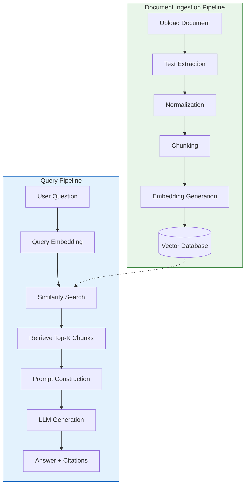

# AIRAG - Learning-Driven RAG Application

> **A Retrieval-Augmented Generation application built as a structured learning journey.**  
> This project serves both as a portfolio-quality RAG system and a comprehensive educational resource for understanding the architecture, concepts, and implementation of modern RAG pipelines.

---

## Project Overview

AIRAG (AI Retrieval-Augmented Generation) is a personal knowledge base and document question-answering system. It enables users to upload documents (PDF, Markdown, TXT, DOCX), process them into searchable chunks, and ask natural-language questions that are answered using only the information contained in the uploaded documents.

**Current Status:** Phase 0 – Project Foundation (Repository initialized, planning complete)

---

## Project Goals and Learning Objectives

### Software Engineering Goals
- Build a functional, maintainable, and portfolio-quality RAG application
- Follow professional software engineering practices (clean code, testing, documentation, Git workflows)
- Design for extensibility: modular architecture supporting future enhancements

### Learning Objectives
- **Understand** the theoretical foundations: LLMs, Transformers, tokens, embeddings, vector search
- **Implement** each RAG component from first principles before adopting libraries
- **Evaluate** trade-offs between chunking strategies, embedding models, retrieval parameters
- **Debug** and **optimize** the pipeline through experimentation
- **Document** decisions and learnings for future reference

---

## Key Features

| Feature | Status | Description |
|---------|--------|-------------|
| Document upload (PDF, MD, TXT, DOCX) | 📋 Planned | Multi-format document ingestion |
| Text extraction & normalization | 📋 Planned | Preserve metadata, handle extraction errors |
| Configurable text chunking | 📋 Planned | Chunk size, overlap, strategy comparison |
| Embedding generation | 📋 Planned | Sentence Transformers, model comparison |
| Vector database (ChromaDB) | 📋 Planned | Store embeddings + metadata, similarity search |
| Semantic retrieval | 📋 Planned | Top-k, similarity thresholds, quality evaluation |
| LLM integration (Ollama) | 📋 Planned | Local LLM, prompt construction, source attribution |
| FastAPI REST API | 📋 Planned | Document management, Q&A endpoints, OpenAPI docs |
| Conversation history | 📋 Planned | Multi-turn dialogue support |
| React frontend | 📋 Planned | Document UI, chat interface, citations |
| Advanced RAG (reranking, hybrid search, etc.) | 📋 Planned | Phase 10+ enhancements |
| Production readiness (Docker, monitoring, security) | 📋 Planned | Phase 11+ |

**Legend:** ✅ Implemented | 🔄 In Progress | 📋 Planned | 🚫 Not Started

---

## Technology Stack

### Backend
| Component | Technology | Purpose |
|-----------|------------|---------|
| API Framework | **FastAPI** | High-performance async REST API with automatic OpenAPI docs |
| Data Validation | **Pydantic** | Type-safe request/response models |
| ASGI Server | **Uvicorn** | Production-grade async server |

### Document Processing
| Format | Library |
|--------|---------|
| PDF | **PyMuPDF (fitz)** |
| DOCX | **python-docx** |
| Markdown/TXT | Native Python |

### RAG & AI
| Component | Technology | Notes |
|-----------|------------|-------|
| Embeddings | **Sentence Transformers** | `all-MiniLM-L6-v2` (384-dim, CPU-friendly) |
| Vector DB | **ChromaDB** | Local, persistent, no separate server needed |
| Local LLM | **Ollama** | `llama3.2:3b` or `phi3:mini` for 8GB VRAM |
| LLM Abstraction | Custom interface | Swappable: Ollama, OpenAI, Anthropic, etc. |

### Development & Infrastructure
| Tool | Purpose |
|------|---------|
| **pytest** | Unit & integration testing |
| **Docker / Docker Compose** | Containerization |
| **python-dotenv** | Environment variable management |
| **Git / GitHub** | Version control, CI/CD ready |

### Frontend (Future)
- **React** (TypeScript) – Phase 9+

---

## High-Level RAG Architecture



### Component Interaction

```
┌─────────────────────────────────────────────────────────────────┐
│                        AIRAG APPLICATION                        │
├─────────────────────────────────────────────────────────────────┤
│  ┌──────────────┐  ┌──────────────┐  ┌──────────────┐          │
│  │   Ingestion  │  │   Retrieval  │  │  Generation  │          │
│  │   Service    │──▶│   Service    │──▶│   Service    │          │
│  └──────────────┘  └──────────────┘  └──────────────┘          │
│         │                │                │                      │
│         ▼                ▼                ▼                      │
│  ┌──────────────┐  ┌──────────────┐  ┌──────────────┐          │
│  │ Document     │  │ Vector Store │  │ LLM Provider │          │
│  │ Loaders      │  │ (ChromaDB)   │  │ (Ollama/API) │          │
│  └──────────────┘  └──────────────┘  └──────────────┘          │
└─────────────────────────────────────────────────────────────────┘
```

---

## How RAG Works: The Pipeline

### 1. Document Ingestion
```
Document → Extract Text → Normalize → Chunk → Embed → Store in Vector DB
```
- **Extraction**: Pull raw text + metadata (page numbers, headers) from files
- **Normalization**: Clean whitespace, fix encoding, standardize formatting
- **Chunking**: Split into overlapping segments (e.g., 500 tokens, 50 overlap)
- **Embedding**: Convert each chunk to a dense vector (semantic representation)
- **Storage**: Persist vectors + chunk text + metadata in ChromaDB

### 2. Query Processing
```
Question → Embed → Vector Search → Retrieve Top-K → Build Prompt → Generate Answer
```
- **Query Embedding**: Same model as document embeddings for semantic alignment
- **Similarity Search**: Cosine similarity in vector space finds relevant chunks
- **Context Assembly**: Combine retrieved chunks into structured prompt
- **Grounded Generation**: LLM answers using ONLY provided context
- **Attribution**: Return answer with source document + chunk references

### Key Principle: Grounding
> The LLM **must not** use parametric knowledge. Answers come exclusively from retrieved documents. When context is insufficient, the system explicitly states this.

---

## Project Roadmap and Development Phases

### Phase 0 – Project Foundation ✅ *Current*
- [x] Repository initialized
- [x] Architecture planned
- [x] Technology stack selected
- [ ] Python environment setup
- [ ] Dependency management (pyproject.toml / requirements.txt)
- [ ] .gitignore, .env.example
- [ ] Development conventions documented

### Phase 1 – Understanding RAG Concepts 📋
*Before coding: interactive learning sessions with code demonstrations*
- What are LLMs, Transformers, tokens?
- What are embeddings and vector space?
- Semantic search vs keyword search
- Vector databases and ANN algorithms
- Complete RAG pipeline walkthrough

### Phase 2 – Document Ingestion 📋
- Multi-format loaders (PDF, DOCX, MD, TXT)
- Metadata preservation (source, page, section)
- Error handling for corrupted/unsupported files
- Unit tests for each loader

### Phase 3 – Text Chunking 📋
- Configurable chunk size / overlap
- Strategies: fixed-size, sentence-aware, semantic
- Metadata propagation to chunks
- Visualization of chunk boundaries

### Phase 4 – Embeddings 📋
- Sentence Transformers integration
- Model comparison (MiniLM, MPNet, E5, BGE)
- Batch embedding generation
- Dimension and similarity metric analysis

### Phase 5 – Vector Database 📋
- ChromaDB setup (persistent client)
- Collection management
- CRUD operations for documents/chunks
- Similarity search with filters

### Phase 6 – Retrieval Pipeline 📋
- Query preprocessing
- Top-k retrieval with thresholds
- Retrieval evaluation (precision/recall concepts)
- Metadata filtering

### Phase 7 – LLM Integration & Generation 📋
- Ollama client wrapper
- Prompt templates (system, user, context)
- Streaming responses
- Source citation formatting
- "I don't know" handling

### Phase 8 – Complete RAG API 📋
- FastAPI application structure
- REST endpoints: documents, queries, health
- OpenAPI/Swagger documentation
- Integration tests
- Error handling & validation

### Phase 9 – Frontend 📋
- React + TypeScript setup
- Document upload & management UI
- Chat interface with citations
- Conversation history panel

### Phase 10 – Advanced RAG 📋
- Hybrid search (BM25 + vector)
- Reranking (cross-encoders)
- Query rewriting / multi-query
- Parent-child chunking
- Agentic RAG patterns

### Phase 11 – Production Readiness 📋
- Docker multi-stage builds
- Structured logging (structlog)
- Configuration management (pydantic-settings)
- Security (input validation, rate limiting)
- Monitoring (Prometheus/Grafana hooks)
- Deployment documentation

---

## Repository Structure

```
airag/
├── .github/                    # GitHub workflows, templates
├── .kilo/                      # Kilo configuration
├── docs/                       # Documentation
│   ├── ARCHITECTURE.md         # System architecture details
│   ├── LEARNING_ROADMAP.md     # Phase-by-phase learning guide
│   ├── RAG_CONCEPTS.md         # Core RAG theory explanations
│   ├── DEVELOPMENT_LOG.md      # Chronological development notes
│   ├── DECISIONS.md            # Architectural decision records (ADRs)
│   └── API.md                  # API documentation
├── src/                        # Application source code
│   ├── airag/
│   │   ├── __init__.py
│   │   ├── config.py           # Settings management
│   │   ├── core/               # Core domain logic
│   │   │   ├── models.py       # Pydantic models
│   │   │   ├── exceptions.py   # Custom exceptions
│   │   ├── ingestion/          # Document ingestion pipeline
│   │   │   ├── loaders/        # Format-specific loaders
│   │   │   ├── chunkers/       # Chunking strategies
│   │   │   └── pipeline.py     # Ingestion orchestration
│   │   ├── embeddings/         # Embedding generation
│   │   │   ├── base.py         # Abstract interface
│   │   │   └── sentence_transformers.py
│   │   ├── retrieval/          # Retrieval pipeline
│   │   │   ├── vector_store.py # ChromaDB wrapper
│   │   │   ├── search.py       # Similarity search
│   │   │   └── rerank.py       # Future: reranking
│   │   ├── generation/         # LLM integration
│   │   │   ├── base.py         # Abstract LLM interface
│   │   │   ├── ollama.py       # Ollama implementation
│   │   │   └── prompts.py      # Prompt templates
│   │   ├── api/                # FastAPI application
│   │   │   ├── routes/         # API endpoints
│   │   │   ├── middleware/     # Custom middleware
│   │   │   └── main.py         # App factory
│   │   └── services/           # High-level service orchestration
│   └── tests/                  # Test suite
│       ├── unit/
│       ├── integration/
│       └── fixtures/
├── docker/                     # Docker configurations
├── scripts/                    # Utility scripts
├── .env.example                # Environment template
├── .gitignore
├── pyproject.toml              # Project config & dependencies
├── requirements.txt            # Pinned dependencies
├── docker-compose.yml
├── Dockerfile
├── README.md                   # This file
└── LICENSE
```

---

## Getting Started

> **Note:** Setup instructions will be expanded as each phase is implemented.

### Prerequisites
- Python 3.10+ (tested on 3.11+)
- Git
- (Optional) Docker & Docker Compose
- (For local LLM) [Ollama](https://ollama.ai) installed

### Quick Start (Planned)
```bash
# Clone repository
git clone https://github.com/alireza15bagheri/AIRAG.git
cd AIRAG

# Create virtual environment
python -m venv .venv
source .venv/bin/activate  # Windows: .venv\Scripts\activate

# Install dependencies
pip install -r requirements.txt

# Configure environment
cp .env.example .env
# Edit .env with your settings

# Start services (when available)
docker-compose up -d

# Run API (when implemented)
uvicorn airag.api.main:app --reload
```

### Hardware Considerations
| Component | Recommendation | Minimum |
|-----------|----------------|---------|
| RAM | 16 GB+ | 8 GB |
| GPU VRAM | 8 GB (AMD RX 5700 XT) | 4 GB |
| Storage | 10 GB free | 5 GB |
| CPU | Modern multi-core | 4 cores |

**Embedding Model:** `all-MiniLM-L6-v2` (384-dim, ~90 MB, runs on CPU)  
**Local LLM Options:** `llama3.2:3b` (~2 GB), `phi3:mini` (~2.3 GB), `gemma2:2b` (~1.6 GB)

---

## Learning Resources and Documentation

| Document | Purpose |
|----------|---------|
| [LEARNING_ROADMAP.md](docs/LEARNING_ROADMAP.md) | Step-by-step learning path with exercises |
| [RAG_CONCEPTS.md](docs/RAG_CONCEPTS.md) | Deep-dive into RAG theory and components |
| [ARCHITECTURE.md](docs/ARCHITECTURE.md) | System design, data flows, component diagrams |
| [DECISIONS.md](docs/DECISIONS.md) | Architectural Decision Records (ADRs) |
| [DEVELOPMENT_LOG.md](docs/DEVELOPMENT_LOG.md) | Daily progress, blockers, solutions |

### Recommended External Resources
- **Books:** *Building LLMs for Production* (Huyen), *Natural Language Processing with Transformers* (Tunstall et al.)
- **Papers:** "Attention Is All You Need" (Vaswani et al.), "Retrieval-Augmented Generation" (Lewis et al., 2020)
- **Courses:** Fast.ai Practical Deep Learning, Hugging Face NLP Course

---

## Testing

### Test Strategy
| Level | Scope | Tools |
|-------|-------|-------|
| Unit | Individual functions/classes | `pytest`, `pytest-mock` |
| Integration | Service interactions, API endpoints | `pytest`, `httpx` |
| E2E | Full pipeline (ingestion → answer) | `pytest`, test fixtures |

### Running Tests (Planned)
```bash
# All tests
pytest

# Unit tests only
pytest src/tests/unit -v

# Integration tests only
pytest src/tests/integration -v

# With coverage
pytest --cov=airag --cov-report=html
```

---

## Future Improvements

### Near-term (Post-Phase 8)
- [ ] Hybrid search (BM25 + dense vectors)
- [ ] Cross-encoder reranking
- [ ] Query rewriting / multi-query retrieval
- [ ] Parent-child chunking for better context
- [ ] Metadata-aware filtering (date, tags, source)

### Long-term
- [ ] Agentic RAG (tool use, multi-step reasoning)
- [ ] RAG evaluation framework (RAGAS, TruLens)
- [ ] Multi-knowledge-base support
- [ ] Incremental document updates
- [ ] Distributed vector search (Qdrant, Milvus)
- [ ] Fine-tuned embedding models for domain adaptation

---

## Contributing

This is a personal learning project, but suggestions are welcome via GitHub Issues.

### Development Workflow
1. Create feature branch: `feature/descriptive-name`
2. Implement with tests
3. Update documentation
4. Conventional commit: `feat: add document chunking`
5. Open PR for review

---

## License

MIT License – see [LICENSE](LICENSE) for details.

---

## Acknowledgments

Built as a structured learning journey. Special thanks to the open-source communities behind:
- FastAPI, ChromaDB, Sentence Transformers, Ollama, PyMuPDF, python-docx

---

**Last Updated:** 2026-11-08 | **Phase:** 0 – Project Foundation