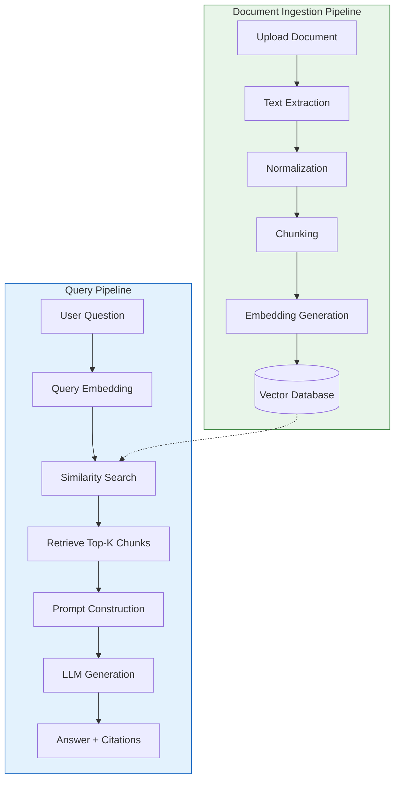

# AIRAG - Learning-Driven RAG Application

> **A Retrieval-Augmented Generation application built as a structured learning journey.**  
> This project serves both as a portfolio-quality RAG system and a comprehensive educational resource for understanding the architecture, concepts, and implementation of modern RAG pipelines.

---

## Project Overview

AIRAG (AI Retrieval-Augmented Generation) is a personal knowledge base and document question-answering system. It enables users to upload documents (PDF, Markdown, TXT, DOCX), process them into searchable chunks, and ask natural-language questions that are answered using only the information contained in the uploaded documents.

**Current Status:** Phase 0 – Project Foundation ✅ **Complete** | Next: Phase 1 – Understanding RAG Concepts

---

## Project Goals and Learning Objectives

### Software Engineering Goals
- Build a functional, maintainable, and portfolio-quality RAG application
- Follow professional software engineering practices (clean code, testing, documentation, Git workflows)
- Design for extensibility: modular architecture supporting future enhancements

### Learning Objectives
- **Understand** the theoretical foundations: LLMs, Transformers, tokens, embeddings, vector search
- **Implement** each RAG component from first principles before adopting libraries
- **Evaluate** trade-offs between chunking strategies, embedding models, retrieval parameters
- **Debug** and **optimize** the pipeline through experimentation
- **Document** decisions and learnings for future reference

---

## Key Features

| Feature | Status | Description |
|---------|--------|-------------|
| Document upload (PDF, MD, TXT, DOCX) | 📋 Planned | Multi-format document ingestion |
| Text extraction & normalization | 📋 Planned | Preserve metadata, handle extraction errors |
| Configurable text chunking | 📋 Planned | Chunk size, overlap, strategy comparison |
| Embedding generation | 📋 Planned | Sentence Transformers, model comparison |
| Vector database (ChromaDB) | 📋 Planned | Store embeddings + metadata, similarity search |
| Semantic retrieval | 📋 Planned | Top-k, similarity thresholds, quality evaluation |
| LLM integration (Ollama) | 📋 Planned | Local LLM, prompt construction, source attribution |
| FastAPI REST API | 📋 Planned | Document management, Q&A endpoints, OpenAPI docs |
| Conversation history | 📋 Planned | Multi-turn dialogue support |
| React frontend | 📋 Planned | Document UI, chat interface, citations |
| Advanced RAG (reranking, hybrid search, etc.) | 📋 Planned | Phase 10+ enhancements |
| Production readiness (Docker, monitoring, security) | 📋 Planned | Phase 11+ |

**Legend:** ✅ Implemented | 🔄 In Progress | 📋 Planned | 🚫 Not Started

---

## Technology Stack

### Backend
| Component | Technology | Version | Purpose |
|-----------|------------|---------|---------|
| API Framework | **FastAPI** | 0.162.2 | High-performance async REST API with automatic OpenAPI docs |
| Data Validation | **Pydantic** | 2.14.3 | Type-safe request/response models |
| Settings Management | **Pydantic-Settings** | 2.16.2 | Environment-based configuration |
| ASGI Server | **Uvicorn** | 0.54.0 | Production-grade async server |

### Document Processing
| Format | Library | Version |
|--------|---------|---------|
| PDF | **PyMuPDF (fitz)** | 1.28.2 |
| DOCX | **python-docx** | 1.2.0 |
| Markdown/TXT | **markdown** | 3.11.3 |

### RAG & AI
| Component | Technology | Version | Notes |
|-----------|------------|---------|-------|
| Embeddings | **Sentence Transformers** | 6.2.0 | `all-MiniLM-L6-v2` (384-dim, CPU-friendly) |
| ML Backend | **PyTorch** | 2.15.0 | CPU build (no CUDA required) |
| Transformers | **HuggingFace Transformers** | 5.22.2 | Model utilities, tokenizers |
| Acceleration | **Accelerate** | 1.15.0 | Optimized inference |
| Vector DB | **ChromaDB** | 1.5.9 | Local, persistent, no separate server needed |
| Local LLM | **Ollama** | 0.6.3 | `llama3.2:3b` or `phi3:mini` for 8GB VRAM |
| HTTP Client | **HTTPX** | 0.28.1 | Async requests for LLM APIs |
| LLM Abstraction | Custom interface | — | Swappable: Ollama, OpenAI, Anthropic, etc. |

### Development & Infrastructure
| Tool | Purpose |
|------|---------|
| **pytest** | Unit & integration testing (dev dependency) |
| **Docker / Docker Compose** | Containerization (planned) |
| **python-dotenv** | Environment variable management |
| **Git / GitHub** | Version control, CI/CD ready |
| **Ruff** | Linting & formatting (dev dependency) |
| **MyPy** | Type checking (dev dependency) |

### Frontend (Future)
- **React** (TypeScript) – Phase 9+

---

## High-Level RAG Architecture



### Component Interaction

```
┌─────────────────────────────────────────────────────────────────┐
│                        AIRAG APPLICATION                        │
├─────────────────────────────────────────────────────────────────┤
│  ┌──────────────┐  ┌──────────────┐  ┌──────────────┐          │
│  │   Ingestion  │  │   Retrieval  │  │  Generation  │          │
│  │   Service    │──▶│   Service    │──▶│   Service    │          │
│  └──────────────┘  └──────────────┘  └──────────────┘          │
│         │                │                │                      │
│         ▼                ▼                ▼                      │
│  ┌──────────────┐  ┌──────────────┐  ┌──────────────┐          │
│  │ Document     │  │ Vector Store │  │ LLM Provider │          │
│  │ Loaders      │  │ (ChromaDB)   │  │ (Ollama/API) │          │
│  └──────────────┘  └──────────────┘  └──────────────┘          │
└─────────────────────────────────────────────────────────────────┘
```

---

## How RAG Works: The Pipeline

### 1. Document Ingestion
```
Document → Extract Text → Normalize → Chunk → Embed → Store in Vector DB
```
- **Extraction**: Pull raw text + metadata (page numbers, headers) from files
- **Normalization**: Clean whitespace, fix encoding, standardize formatting
- **Chunking**: Split into overlapping segments (e.g., 500 tokens, 50 overlap)
- **Embedding**: Convert each chunk to a dense vector (semantic representation)
- **Storage**: Persist vectors + chunk text + metadata in ChromaDB

### 2. Query Processing
```
Question → Embed → Vector Search → Retrieve Top-K → Build Prompt → Generate Answer
```
- **Query Embedding**: Same model as document embeddings for semantic alignment
- **Similarity Search**: Cosine similarity in vector space finds relevant chunks
- **Context Assembly**: Combine retrieved chunks into structured prompt
- **Grounded Generation**: LLM answers using ONLY provided context
- **Attribution**: Return answer with source document + chunk references

### Key Principle: Grounding
> The LLM **must not** use parametric knowledge. Answers come exclusively from retrieved documents. When context is insufficient, the system explicitly states this.

---

## Project Roadmap and Development Phases

### Phase 0 – Project Foundation ✅ **Complete**
- [x] Repository initialized with Git remote (`origin` → GitHub)
- [x] Architecture planned and documented
- [x] Technology stack selected and documented
- [x] Python environment setup (Python 3.15.2, `.venv` virtual environment)
- [x] Dependency management (`pyproject.toml` + `requirements.txt` with pinned versions)
- [x] `.gitignore` configured (Python, IDE, OS, ML artifacts, HuggingFace cache)
- [x] `.env.example` created with all configuration options
- [x] Development conventions documented in README
- [x] Source package scaffold: `src/airag/` with `__init__.py`, `config.py`, `core/`
- [x] Tests directory created: `tests/`
- [x] All core dependencies installed and verified (70+ packages via Tsinghua mirror)
- [x] Configuration system: Pydantic Settings loading from `.env` with validation

> **Note on Python 3.15 + onnxruntime:** ChromaDB 1.5.9 requires `onnxruntime` which has no wheel for Python 3.15 yet. **Workaround**: Use `SentenceTransformerEmbeddingFunction` (our intended architecture) instead of ChromaDB's default ONNX embedder. Verified working.

### Phase 1 – Understanding RAG Concepts 📋 **Next**
*Before coding: interactive learning sessions with code demonstrations*
- What are LLMs, Transformers, tokens?
- What are embeddings and vector space?
- Semantic search vs keyword search
- Vector databases and ANN algorithms
- Complete RAG pipeline walkthrough

### Phase 2 – Document Ingestion 📋
- Multi-format loaders (PDF, DOCX, MD, TXT)
- Metadata preservation (source, page, section)
- Error handling for corrupted/unsupported files
- Unit tests for each loader

### Phase 3 – Text Chunking 📋
- Configurable chunk size / overlap
- Strategies: fixed-size, sentence-aware, semantic
- Metadata propagation to chunks
- Visualization of chunk boundaries

### Phase 4 – Embeddings 📋
- Sentence Transformers integration
- Model comparison (MiniLM, MPNet, E5, BGE)
- Batch embedding generation
- Dimension and similarity metric analysis

### Phase 5 – Vector Database 📋
- ChromaDB setup (persistent client)
- Collection management
- CRUD operations for documents/chunks
- Similarity search with filters

### Phase 6 – Retrieval Pipeline 📋
- Query preprocessing
- Top-k retrieval with thresholds
- Retrieval evaluation (precision/recall concepts)
- Metadata filtering

### Phase 7 – LLM Integration & Generation 📋
- Ollama client wrapper
- Prompt templates (system, user, context)
- Streaming responses
- Source citation formatting
- "I don't know" handling

### Phase 8 – Complete RAG API 📋
- FastAPI application structure
- REST endpoints: documents, queries, health
- OpenAPI/Swagger documentation
- Integration tests
- Error handling & validation

### Phase 9 – Frontend 📋
- React + TypeScript setup
- Document upload & management UI
- Chat interface with citations
- Conversation history panel

### Phase 10 – Advanced RAG 📋
- Hybrid search (BM25 + vector)
- Reranking (cross-encoders)
- Query rewriting / multi-query
- Parent-child chunking
- Agentic RAG patterns

### Phase 11 – Production Readiness 📋
- Docker multi-stage builds
- Structured logging (structlog)
- Configuration management (pydantic-settings)
- Security (input validation, rate limiting)
- Monitoring (Prometheus/Grafana hooks)
- Deployment documentation

---

## Repository Structure

```
airag/
├── .github/                    # GitHub workflows, templates (future)
├── .kilo/                      # Kilo configuration
├── docs/                       # Documentation (to be created in Phase 1+)
│   ├── ARCHITECTURE.md         # System architecture details (placeholder)
│   ├── LEARNING_ROADMAP.md     # Phase-by-phase learning guide (placeholder)
│   ├── RAG_CONCEPTS.md         # Core RAG theory explanations (placeholder)
│   ├── DEVELOPMENT_LOG.md      # Chronological development notes (placeholder)
│   ├── DECISIONS.md            # Architectural decision records (ADRs) (placeholder)
│   └── API.md                  # API documentation (future)
├── src/                        # Application source code
│   ├── airag/
│   │   ├── __init__.py         # Package init, exports settings
│   │   ├── config.py           # Pydantic Settings (loads .env, validates)
│   │   └── core/               # Core domain logic (empty, ready for models/exceptions)
│   └── tests/                  # Test suite (empty)
│       ├── unit/
│       ├── integration/
│       └── fixtures/
├── .env.example                # Environment template
├── .gitignore                  # Updated with ML/artifact patterns
├── pyproject.toml              # Project config, dependencies, tooling
├── requirements.txt            # Pinned dependencies (actual installed versions)
├── README.md                   # This file
└── LICENSE                     # MIT License (to be added)
```

> **Directories not yet created:** `docs/`, `docker/`, `scripts/`, `docker-compose.yml`, `Dockerfile` — will be added in later phases.

---

## Getting Started

### Prerequisites
- Python 3.10+ (tested on 3.15.2)
- Git
- (Optional) Docker & Docker Compose — for Phase 11+
- (For local LLM) [Ollama](https://ollama.ai) installed

### Quick Start (Verified)
```bash
# Clone repository
git clone https://github.com/alireza15bagheri/AIRAG.git
cd AIRAG

# Create virtual environment
python -m venv .venv
source .venv/bin/activate  # Windows: .venv\Scripts\activate

# Install dependencies (use Tsinghua mirror if PyPI is slow)
pip install -r requirements.txt
# Or: pip install --index-url https://pypi.tuna.tsinghua.edu.cn/simple -r requirements.txt

# Configure environment
cp .env.example .env
# Edit .env with your settings

# Verify installation
python -c "
import fastapi, uvicorn, pydantic, chromadb, sentence_transformers
import torch, transformers, ollama, httpx, fitz, docx, markdown
print('✅ All core packages import successfully')
"
```

### Hardware Considerations
| Component | Recommendation | Minimum |
|-----------|----------------|---------|
| RAM | 16 GB+ | 8 GB |
| GPU VRAM | 8 GB (AMD RX 5700 XT) | 4 GB |
| Storage | 10 GB free | 5 GB |
| CPU | Modern multi-core | 4 cores |

**Embedding Model:** `all-MiniLM-L6-v2` (384-dim, ~90 MB, runs on CPU)  
**Local LLM Options:** `llama3.2:3b` (~2 GB), `phi3:mini` (~2.3 GB), `gemma2:2b` (~1.6 GB)

---

## Learning Resources and Documentation

| Document | Purpose | Status |
|----------|---------|--------|
| [LEARNING_ROADMAP.md](docs/LEARNING_ROADMAP.md) | Step-by-step learning path with exercises | Placeholder (Phase 1) |
| [RAG_CONCEPTS.md](docs/RAG_CONCEPTS.md) | Deep-dive into RAG theory and components | Placeholder (Phase 1) |
| [ARCHITECTURE.md](docs/ARCHITECTURE.md) | System design, data flows, component diagrams | Placeholder (Phase 1) |
| [DECISIONS.md](docs/DECISIONS.md) | Architectural Decision Records (ADRs) | Placeholder (Phase 1) |
| [DEVELOPMENT_LOG.md](docs/DEVELOPMENT_LOG.md) | Daily progress, blockers, solutions | Placeholder (ongoing) |

### Recommended External Resources
- **Books:** *Building LLMs for Production* (Huyen), *Natural Language Processing with Transformers* (Tunstall et al.)
- **Papers:** "Attention Is All You Need" (Vaswani et al.), "Retrieval-Augmented Generation" (Lewis et al., 2020)
- **Courses:** Fast.ai Practical Deep Learning, Hugging Face NLP Course

---

## Testing

### Test Strategy
| Level | Scope | Tools |
|-------|-------|-------|
| Unit | Individual functions/classes | `pytest`, `pytest-mock` |
| Integration | Service interactions, API endpoints | `pytest`, `httpx` |
| E2E | Full pipeline (ingestion → answer) | `pytest`, test fixtures |

### Running Tests (Planned)
```bash
# All tests
pytest

# Unit tests only
pytest src/tests/unit -v

# Integration tests only
pytest src/tests/integration -v

# With coverage
pytest --cov=airag --cov-report=html
```

---

## Future Improvements

### Near-term (Post-Phase 8)
- [ ] Hybrid search (BM25 + dense vectors)
- [ ] Cross-encoder reranking
- [ ] Query rewriting / multi-query retrieval
- [ ] Parent-child chunking for better context
- [ ] Metadata-aware filtering (date, tags, source)

### Long-term
- [ ] Agentic RAG (tool use, multi-step reasoning)
- [ ] RAG evaluation framework (RAGAS, TruLens)
- [ ] Multi-knowledge-base support
- [ ] Incremental document updates
- [ ] Distributed vector search (Qdrant, Milvus)
- [ ] Fine-tuned embedding models for domain adaptation

---

## Contributing

This is a personal learning project, but suggestions are welcome via GitHub Issues.

### Development Workflow
1. Create feature branch: `feature/descriptive-name`
2. Implement with tests
3. Update documentation
4. Conventional commit: `feat: add document chunking`
5. Open PR for review

---

## License

MIT License – see [LICENSE](LICENSE) for details.

---

## Acknowledgments

Built as a structured learning journey. Special thanks to the open-source communities behind:
- FastAPI, ChromaDB, Sentence Transformers, Ollama, PyMuPDF, python-docx, HuggingFace Transformers, PyTorch

---

## Phase 0 Completion Summary

| Deliverable | Status |
|-------------|--------|
| Git repository with remote | ✅ |
| Python 3.15 virtual environment | ✅ |
| pyproject.toml (build config, deps, tooling) | ✅ |
| requirements.txt (pinned actual versions) | ✅ |
| .gitignore (comprehensive) | ✅ |
| .env.example (all config options) | ✅ |
| src/airag/ package scaffold | ✅ |
| config.py (Pydantic Settings) | ✅ |
| __init__.py (exports settings) | ✅ |
| core/ directory (ready for models/exceptions) | ✅ |
| tests/ directory (ready for test suite) | ✅ |
| All 70+ dependencies installed & verified | ✅ |
| README.md updated with actual status | ✅ |

---

**Last Updated:** 2026-11-08 | **Phase:** 0 – Project Foundation ✅ Complete | **Next:** Phase 1 – Understanding RAG Concepts