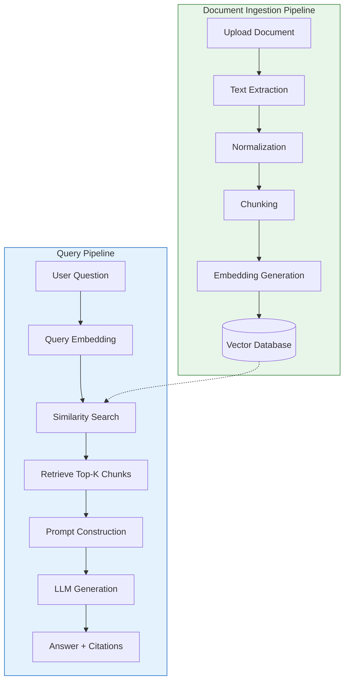

# AIRAG - Learning-Driven RAG Application

> **A Retrieval-Augmented Generation application built as a structured learning journey.**  
> This project serves both as a portfolio-quality RAG system and a comprehensive educational resource for understanding the architecture, concepts, and implementation of modern RAG pipelines.

---

## Project Overview

AIRAG (AI Retrieval-Augmented Generation) is a personal knowledge base and document question-answering system. It enables users to upload documents (PDF, Markdown, TXT, DOCX), process them into searchable chunks, and ask natural-language questions that are answered using only the information contained in the uploaded documents.

**Current Status:** Phase 1 – Understanding RAG Concepts ✅ **Complete** | Phase 2 – Document Ingestion 🔄 **In Progress** (loaders 2.1.1–2.1.4, models 2.2.1, metadata 2.2.2–2.2.5, ingestion service + CLI done; next: 2.3 chunking)

---

## Project Goals and Learning Objectives

### Software Engineering Goals
- Build a functional, maintainable, and portfolio-quality RAG application
- Follow professional software engineering practices (clean code, testing, documentation, Git workflows)
- Design for extensibility: modular architecture supporting future enhancements

### Learning Objectives
- **Understand** the theoretical foundations: LLMs, Transformers, tokens, embeddings, vector search
- **Implement** each RAG component from first principles before adopting libraries
- **Evaluate** trade-offs between chunking strategies, embedding models, retrieval parameters
- **Debug** and **optimize** the pipeline through experimentation
- **Document** decisions and learnings for future reference

---

## Key Features
 
| Feature | Status | Description |
|---------|--------|-------------|
| Document upload (PDF, MD, TXT, DOCX) | ✅ Implemented | Multi-format loaders + extension factory |
| Text extraction & normalization | ✅ Implemented | Metadata preserved, encoding/whitespace normalized, errors wrapped |
| Recursive directory ingestion & CLI | ✅ Implemented | Discovery, hash deduplication, JSON/human output |
| Configurable text chunking | 📋 Planned | Chunk size, overlap, strategy comparison |
| Embedding generation | ✅ Implemented | Sentence Transformers, model comparison |
| Vector database (ChromaDB) | ✅ Implemented | Store embeddings + metadata, similarity search |
| Semantic retrieval | ✅ Implemented | Top-k, similarity thresholds, quality evaluation |
| LLM integration (Ollama) | 📋 Planned | Local LLM, prompt construction, source attribution |
| FastAPI REST API | 📋 Planned | Document management, Q&A endpoints, OpenAPI docs |
| Conversation history | 📋 Planned | Multi-turn dialogue support |
| React frontend | 📋 Planned | Document UI, chat interface, citations |
| Advanced RAG (reranking, hybrid search, etc.) | 📋 Planned | Phase 10+ enhancements |
| Production readiness (Docker, monitoring, security) | 📋 Planned | Phase 11+ |

**Legend:** ✅ Implemented | 🔄 In Progress | 📋 Planned | 🚫 Not Started

---

## Technology Stack

### Backend
| Component | Technology | Version | Purpose |
|-----------|------------|---------|---------|
| API Framework | **FastAPI** | 0.162.2 | High-performance async REST API with automatic OpenAPI docs |
| Data Validation | **Pydantic** | 2.14.3 | Type-safe request/response models |
| Settings Management | **Pydantic-Settings** | 2.16.2 | Environment-based configuration |
| ASGI Server | **Uvicorn** | 0.54.0 | Production-grade async server |

### Document Processing
| Format | Library | Version |
|--------|---------|---------|
| PDF | **PyMuPDF (fitz)** | 1.28.2 |
| DOCX | **python-docx** | 1.2.0 |
| Markdown/TXT | **markdown** | 3.11.3 |

### RAG & AI
| Component | Technology | Version | Notes |
|-----------|------------|---------|-------|
| Embeddings | **Sentence Transformers** | 6.2.0 | `all-MiniLM-L6-v2` (384-dim, CPU-friendly) |
| ML Backend | **PyTorch** | 2.15.0 | CPU build (no CUDA required) |
| Transformers | **HuggingFace Transformers** | 5.22.2 | Model utilities, tokenizers |
| Acceleration | **Accelerate** | 1.15.0 | Optimized inference |
| Vector DB | **ChromaDB** | 1.5.9 | Local, persistent, no separate server needed |
| Local LLM | **Ollama** | 0.6.3 | `llama3.2:3b` or `phi3:mini` for 8GB VRAM |
| HTTP Client | **HTTPX** | 0.28.1 | Async requests for LLM APIs |
| LLM Abstraction | Custom interface | — | Swappable: Ollama, OpenAI, Anthropic, etc. |

### Development & Infrastructure
| Tool | Purpose |
|------|---------|
| **pytest** | Unit & integration testing (dev dependency) |
| **Docker / Docker Compose** | Containerization (planned) |
| **python-dotenv** | Environment variable management |
| **Git / GitHub** | Version control, CI/CD ready |
| **Ruff** | Linting & formatting (dev dependency) |
| **MyPy** | Type checking (dev dependency) |

### Frontend (Future)
- **React** (TypeScript) – Phase 9+

---

## High-Level RAG Architecture



### Component Interaction

```
┌─────────────────────────────────────────────────────────────────┐
│                        AIRAG APPLICATION                        │
├─────────────────────────────────────────────────────────────────┤
│  ┌──────────────┐  ┌──────────────┐  ┌──────────────┐          │
│  │   Ingestion  │  │   Retrieval  │  │  Generation  │          │
│  │   Service    │──▶│   Service    │──▶│   Service    │          │
│  └──────────────┘  └──────────────┘  └──────────────┘          │
│         │                │                │                      │
│         ▼                ▼                ▼                      │
│  ┌──────────────┐  ┌──────────────┐  ┌──────────────┐          │
│  │ Document     │  │ Vector Store │  │ LLM Provider │          │
│  │ Loaders      │  │ (ChromaDB)   │  │ (Ollama/API) │          │
│  └──────────────┘  └──────────────┘  └──────────────┘          │
└─────────────────────────────────────────────────────────────────┘
```

---

## How RAG Works: The Pipeline

### 1. Document Ingestion
```
Document → Extract Text → Normalize → Chunk → Embed → Store in Vector DB
```
- **Extraction**: Pull raw text + metadata (page numbers, headers) from files
- **Normalization**: Clean whitespace, fix encoding, standardize formatting
- **Chunking**: Split into overlapping segments (e.g., 500 tokens, 50 overlap)
- **Embedding**: Convert each chunk to a dense vector (semantic representation)
- **Storage**: Persist vectors + chunk text + metadata in ChromaDB

### 2. Query Processing
```
Question → Embed → Vector Search → Retrieve Top-K → Build Prompt → Generate Answer
```
- **Query Embedding**: Same model as document embeddings for semantic alignment
- **Similarity Search**: Cosine similarity in vector space finds relevant chunks
- **Context Assembly**: Combine retrieved chunks into structured prompt
- **Grounded Generation**: LLM answers using ONLY provided context
- **Attribution**: Return answer with source document + chunk references

### Key Principle: Grounding
> The LLM **must not** use parametric knowledge. Answers come exclusively from retrieved documents. When context is insufficient, the system explicitly states this.

---

## Project Roadmap and Development Phases

### Phase 0 – Project Foundation ✅ **Complete**
- [x] Repository initialized with Git remote (`origin` → GitHub)
- [x] Architecture planned and documented
- [x] Technology stack selected and documented
- [x] Python environment setup (Python 3.15.2, `.venv` virtual environment)
- [x] Dependency management (`pyproject.toml` + `requirements.txt` with pinned versions)
- [x] `.gitignore` configured (Python, IDE, OS, ML artifacts, HuggingFace cache)
- [x] `.env.example` created with all configuration options
- [x] Development conventions documented in README
- [x] Source package scaffold: `src/airag/` with `__init__.py`, `config.py`, `core/`
- [x] Tests directory created: `tests/`
- [x] All core dependencies installed and verified (70+ packages via Tsinghua mirror)
- [x] Configuration system: Pydantic Settings loading from `.env` with validation

> **Note on Python 3.15 + onnxruntime:** ChromaDB 1.5.9 requires `onnxruntime` which has no wheel for Python 3.15 yet. **Workaround**: Use `SentenceTransformerEmbeddingFunction` (our intended architecture) instead of ChromaDB's default ONNX embedder. Verified working.

### Phase 1 – Understanding RAG Concepts ✅ **Complete**
*Before coding: interactive learning sessions with code demonstrations*
- What are LLMs, Transformers, tokens?
- What are embeddings and vector space?
- Semantic search vs keyword search
- Vector databases and ANN algorithms
- Complete RAG pipeline walkthrough

### Phase 2 – Document Ingestion 🔄 **In Progress**
- [x] Multi-format loaders: PDF, DOCX, Markdown, TXT (factory-based extension routing)
- [x] Metadata extraction: source, page count, format, dates, encoding, structure
- [x] Error handling for corrupted, encrypted and unsupported files
- [x] `ExtractedDocument` / `LoadResult` models with SHA-256 content hash and timestamps
- [x] Recursive directory ingestion service with content deduplication
- [x] CLI: `python -m src.airag.ingestion.cli {directory,files,extensions}`
- [x] Unit tests for loaders, factory, models, service and CLI (212 passing)
- [x] Chunking contract (step 2.3.1: `Chunker` / `ChunkConfig` / `Chunk`)
- [ ] Concrete chunkers (steps 2.3.2–2.3.4) — **next**
- [ ] Pipeline embedding / vector-store integration (step 2.4)

> **Roadmap note:** the phase headings below are the original learning-journey
> numbering. Chunking (Phase 3), embeddings (Phase 4) and vector storage
> (Phase 5) are tracked in this project as Phase 2 steps **2.3** and **2.4**.
> The detailed section after Phase 11 is authoritative for step numbers,
> file outputs, coverage targets and acceptance criteria.

### Phase 3 – Text Chunking 📋 *(tracked as Phase 2 step 2.3)*
- Configurable chunk size / overlap
- Strategies: fixed-size, sentence-aware, semantic
- Metadata propagation to chunks
- Visualization of chunk boundaries

### Phase 4 – Embeddings 📋 *(tracked as Phase 2 step 2.4.1)*
- Sentence Transformers integration
- Model comparison (MiniLM, MPNet, E5, BGE)
- Batch embedding generation
- Dimension and similarity metric analysis

### Phase 5 – Vector Database 📋 *(tracked as Phase 2 steps 2.4.2–2.4.4)*
- ChromaDB setup (persistent client)
- Collection management
- CRUD operations for documents/chunks
- Similarity search with filters

### Phase 6 – Retrieval Pipeline 📋
- Query preprocessing
- Top-k retrieval with thresholds
- Retrieval evaluation (precision/recall concepts)
- Metadata filtering

### Phase 7 – LLM Integration & Generation 📋
- Ollama client wrapper
- Prompt templates (system, user, context)
- Streaming responses
- Source citation formatting
- "I don't know" handling

### Phase 8 – Complete RAG API 📋
- FastAPI application structure
- REST endpoints: documents, queries, health
- OpenAPI/Swagger documentation
- Integration tests
- Error handling & validation

### Phase 9 – Frontend 📋
- React + TypeScript setup
- Document upload & management UI
- Chat interface with citations
- Conversation history panel

### Phase 10 – Advanced RAG 📋
- Hybrid search (BM25 + vector)
- Reranking (cross-encoders)
- Query rewriting / multi-query
- Parent-child chunking
- Agentic RAG patterns

### Phase 11 – Production Readiness 📋
- Docker multi-stage builds
- Structured logging (structlog)
- Configuration management (pydantic-settings)
- Security (input validation, rate limiting)
- Monitoring (Prometheus/Grafana hooks)
- Deployment documentation

### Phase 2 – Detailed Implementation Plan (authoritative)

Source of truth: `E:\projects\airag_phase2_planning.md` (kept outside the repo).
This section mirrors that plan and adds live status; use **these** step IDs,
output paths and targets when choosing the next development task.

**Strategy:** modular, test-first, configurable, observable — loader abstraction
→ metadata → chunking → embedding/vector store → orchestration/CLI → errors/logging.

#### 2.1 Loader abstraction & factory

| Step | Description | Output | Status |
|------|-------------|--------|--------|
| 2.1.1 | `DocumentLoader` abstract base class | `loaders/base.py` | ✅ |
| 2.1.2 | `PDFLoader` (PyMuPDF) | `loaders/pdf.py` | ✅ |
| 2.1.3 | `DocxLoader`, `MarkdownLoader`, `TextLoader` | `loaders/*.py` | ✅ |
| 2.1.4 | `LoaderFactory` (extension → loader) | `factory.py` | ✅ |

#### 2.2 Text extraction & metadata

| Step | Description | Output | Status |
|------|-------------|--------|--------|
| 2.2.1 | `ExtractedDocument` dataclass | `models.py` | ✅ |
| 2.2.2 | PDF metadata: page count, title, author, dates | `pdf.py::extract_metadata()` | ✅ |
| 2.2.3 | DOCX metadata: core + custom properties | `docx.py::extract_metadata()` | ✅ |
| 2.2.4 | Markdown metadata: frontmatter, heading hierarchy | `markdown.py::extract_metadata()` | ✅ |
| 2.2.5 | Text metadata: encoding, line/char counts | `text.py::extract_metadata()` | ✅ |

#### 2.3 Chunking strategies

| Step | Description | Output | Status |
|------|-------------|--------|--------|
| 2.3.1 | `Chunker` protocol + `ChunkConfig` dataclass | `chunking/base.py` | ✅ (includes `Chunk` value object) |
| 2.3.2 | `FixedSizeChunker` (size + overlap, char/token aware) | `chunking/fixed.py` | 📋 **Next** |
| 2.3.3 | `SentenceAwareChunker` (spaCy / NLTK boundaries) | `chunking/sentence.py` | 📋 |
| 2.3.4 | `SemanticChunker` (embedding-based boundaries) | `chunking/semantic.py` | 📋 |

#### 2.4 Embedding & vector store integration

| Step | Description | Output | Status |
|------|-------------|--------|--------|
| 2.4.1 | `EmbeddingService` (batched, cached, retry) | `embedding.py` | 📋 |
| 2.4.2 | `VectorStoreWriter` (upsert by content hash) | `vector_store.py` | 📋 |
| 2.4.3 | Chunk → embedding → document ID pipeline | `pipeline.py` | 📋 |
| 2.4.4 | Idempotent write: hash → skip if exists | `vector_store.py` | 🔄 Partial (hash + dedup in `models.py`/`service.py`; store upsert pending) |

#### 2.5 Orchestration & CLI

| Step | Description | Output | Status |
|------|-------------|--------|--------|
| 2.5.1 | `IngestionPipeline` (load → extract → chunk → embed → store) | `pipeline.py` | 🔄 Partial (`service.py` does discovery/load/dedup; full pipeline pending) |
| 2.5.2 | CLI: `airag ingest <path> [--recursive] [--config]` | `cli/ingest.py` | ✅ (as `ingestion/cli.py`) |
| 2.5.2* | YAML/JSON config for chunking/embedding/loaders | `config/ingestion.yaml` | 📋 *(numbering as in the source plan)* |
| 2.5.4 | Progress reporting (tqdm), resume/checkpoint | `pipeline.py` | 📋 |

> There is **no step 2.5.5** in the source plan. Directory traversal is a
> 2.5.1 responsibility; the existing service/CLI are documented against 2.5.1/2.5.2.

#### 2.6 Error handling & observability

| Step | Description | Output | Status |
|------|-------------|--------|--------|
| 2.6.1 | Exception hierarchy (`LoadError`, `ChunkError`, `EmbeddingError`) | `exceptions.py` | 🔄 Partial (`UnsupportedFormatError` still has `TODO(2.6.1)`) |
| 2.6.2 | Structured logging (JSON, correlation IDs) | `logging.py` | 📋 |
| 2.6.3 | Metrics: files, chunks, latency | `metrics.py` | 📋 |
| 2.6.4 | Dead letter queue: failed files → retry / review | `pipeline.py` | 📋 |

#### Testing framework and targets

| Module | Target coverage | Current |
|--------|-----------------|---------|
| `loaders/pdf.py` | 90% | 92% |
| `loaders/docx.py` | 90% | 100% |
| `loaders/markdown.py` | 90% | 95% |
| `chunking/base.py` | — (contract; not in plan table) | 100% |
| `chunking/fixed.py` | 95% | — |
| `chunking/sentence.py` | 85% | — |
| `chunking/semantic.py` | 80% | — |
| `embedding.py` | 90% | — |
| `vector_store.py` | 95% | — |

Integration scenarios (8): PDF→chunks→embeddings→ChromaDB; DOCX tables/images;
50-page PDF streaming; corrupted PDF → `LoadError`+DLQ; duplicate file → idempotent
upsert; recursive mixed-format directory; config override (`--chunk-size 500`);
resume after interrupt.
E2E scenarios (3): full ingest→query→answer with citations; incremental update;
metadata filtering.

Test layout: `tests/unit/` (loader, factory, model, service, CLI tests) plus
`tests/unit/ingestion/chunking/` for the 2.3.x contract and strategies, with
`tests/integration/`, `tests/e2e/` and binary `tests/fixtures/` still planned —
generate small fixtures in `tmp_path` instead of committing binaries.

CI/CD gates (from the plan): `pytest tests/unit -x --cov=src/airag/ingestion
--cov-fail-under=85`; `pytest tests/integration -x --timeout=120`; `pytest tests/e2e
-x --timeout=300`; `ruff src/ tests/`; `mypy src/airag/ingestion`. The whole-tree
ruff gate currently has pre-existing debt in `test_pdf.py` and a few loader files.

#### Milestones

| Week | Focus | Deliverable | Status |
|------|-------|-------------|--------|
| 1 | Loaders + factory | All 4 loaders working, factory tested | ✅ |
| 2 | Chunking + metadata | 3 chunkers, full metadata extraction | 🔄 Metadata done; chunking next |
| 3 | Embedding + vector store | Batched embedding, idempotent ChromaDB writes | 📋 |
| 4 | Pipeline + CLI + tests | End-to-end ingest, full test suite green | 🔄 CLI/service early; pipeline pending |

#### Definition of Done (Phase 2)

- [x] All 4 loaders handle varied test files without crashes
- [ ] Chunking strategies produce correct overlap/size
- [ ] Metadata includes: source, page, section, hash, timestamps (`section` not yet defined)
- [ ] Idempotent: re-ingest same dir → 0 new chunks (hash/dedup done; store pending)
- [ ] Resume: interrupt at 50% → restart completes
- [ ] Observability: JSON logs, Prometheus metrics exposed
- [x] Coverage ≥85% unit (current: 97% ingestion, 212 tests)
- [ ] Documentation: `docs/INGESTION.md` with config examples

#### Step 2.3.1 decisions (resolved)

1. `Chunk` lives in `chunking/base.py` — the only output file named by 2.3.1; `models.py` stays the extracted-document model.
2. `Chunker.chunk(document: ExtractedDocument) -> list[Chunk]` so source/page/hash/timestamps propagate.
3. `ChunkConfig` = frozen/slotted `chunk_size`, `overlap`, `length_unit` (`char`|`token`); invalid values raise `ChunkError`.
4. `Chunk` = frozen/slotted `text`, `metadata`, `chunk_index`, `start_char`, `end_char`; no new dependencies.
5. `Chunker` is a `@runtime_checkable` `typing.Protocol`, not an ABC.

#### Next step: 2.3.2 — `FixedSizeChunker` (target `chunking/fixed.py`, 95% coverage)

Open decisions for the next step:
1. Implement `length_unit="token"` now (needs `tiktoken` declared in `pyproject.toml`/`requirements.txt`) or ship character mode first.
2. Handle page boundaries from `ExtractedDocument.pages` (split across pages vs. per-page chunking).
3. Which chunk-specific metadata keys to write (`chunk_index`, `section`, offsets) beyond the inherited document metadata.
4. Deferred: spaCy/NLTK choice for 2.3.3 (neither installed), direct `SentenceTransformer` vs. 2.4.1 `EmbeddingService` for 2.3.4, and `section` derivation for non-markdown formats.

---

## Repository Structure

```
airag/
├── .github/                    # GitHub workflows, templates (future)
├── .kilo/                      # Kilo configuration
├── docs/                       # Documentation (to be created in Phase 1+)
│   ├── ARCHITECTURE.md         # System architecture details (placeholder)
│   ├── LEARNING_ROADMAP.md     # Phase-by-phase learning guide (placeholder)
│   ├── RAG_CONCEPTS.md         # Core RAG theory explanations (placeholder)
│   ├── DEVELOPMENT_LOG.md      # Chronological development notes (placeholder)
│   ├── DECISIONS.md            # Architectural decision records (ADRs) (placeholder)
│   └── API.md                  # API documentation (future)
├── src/                        # Application source code
│   ├── airag/
│   │   ├── __init__.py         # Package init, exports settings
│   │   ├── config.py           # Pydantic Settings (loads .env, validates)
│   │   └── ingestion/          # Phase 2 document ingestion
│   │       ├── __init__.py     # Public ingestion API re-exports
│   │       ├── cli.py          # CLI: extensions / directory / files
│   │       ├── chunking/       # base.py (step 2.3.1); strategies 2.3.2-2.3.4 pending
│   │       ├── exceptions.py   # LoadError, UnsupportedFormatError, etc.
│   │       ├── factory.py      # Extension → loader registry
│   │       ├── models.py       # ExtractedDocument, LoadResult, IngestionResult
│   │       ├── service.py      # Directory traversal + deduplication
│   │       └── loaders/        # base.py, pdf.py, docx.py, markdown.py, text.py
│   └── tests/                  # Test suite
│       ├── unit/               # 191 unit tests
│       ├── integration/        # (planned)
│       └── fixtures/           # (planned)
├── .env.example                # Environment template
├── .gitignore                  # Updated with ML/artifact patterns
├── pyproject.toml              # Project config, dependencies, tooling
├── requirements.txt            # Pinned dependencies (actual installed versions)
├── README.md                   # This file
└── LICENSE                     # MIT License (to be added)
```

> **Directories not yet created:** `docs/`, `docker/`, `scripts/`, `docker-compose.yml`, `Dockerfile` — will be added in later phases.

---

## Getting Started

### Prerequisites
- Python 3.10+ (tested on 3.15.2)
- Git
- (Optional) Docker & Docker Compose — for Phase 11+
- (For local LLM) [Ollama](https://ollama.ai) installed

### Quick Start (Verified)
```bash
# Clone repository
git clone https://github.com/alireza15bagheri/AIRAG.git
cd AIRAG

# Create virtual environment
python -m venv .venv
source .venv/bin/activate  # Windows: .venv\Scripts\activate

# Install dependencies (use Tsinghua mirror if PyPI is slow)
pip install -r requirements.txt
# Or: pip install --index-url https://pypi.tuna.tsinghua.edu.cn/simple -r requirements.txt

# Configure environment
cp .env.example .env
# Edit .env with your settings

# Verify installation
python -c "
import fastapi, uvicorn, pydantic, chromadb, sentence_transformers
import torch, transformers, ollama, httpx, fitz, docx, markdown
print('✅ All core packages import successfully')
"
```

### Document Ingestion CLI

The ingestion CLI loads supported documents without chunking or embedding yet;
it reports per-file results and SHA-256 content hashes.

```bash
# List supported extensions
PYTHONPATH=src ./.venv/Scripts/python.exe -m src.airag.ingestion.cli extensions

# Ingest a directory recursively and write a JSON report
PYTHONPATH=src ./.venv/Scripts/python.exe -m src.airag.ingestion.cli \
  directory path/to/docs -o results.json

# Ingest explicit files with verbose JSON output and fail-fast errors
PYTHONPATH=src ./.venv/Scripts/python.exe -m src.airag.ingestion.cli \
  files a.pdf b.md -v --fail-fast
```

Useful flags: `--no-recursive` (top level only), `-e .txt .md` (extension filter),
`--no-deduplicate` (disable content-hash skipping), `--fail-fast` (raise on the
first load error instead of reporting it), `-o FILE` (JSON report) and `-v`
(verbose JSON on stdout). Duplicate content is skipped by default per run.

### Hardware Considerations
| Component | Recommendation | Minimum |
|-----------|----------------|---------|
| RAM | 16 GB+ | 8 GB |
| GPU VRAM | 8 GB (AMD RX 5700 XT) | 4 GB |
| Storage | 10 GB free | 5 GB |
| CPU | Modern multi-core | 4 cores |

**Embedding Model:** `all-MiniLM-L6-v2` (384-dim, ~90 MB, runs on CPU)  
**Local LLM Options:** `llama3.2:3b` (~2 GB), `phi3:mini` (~2.3 GB), `gemma2:2b` (~1.6 GB)

---

## Learning Resources and Documentation

| Document | Purpose | Status |
|----------|---------|--------|
| [LEARNING_ROADMAP.md](docs/LEARNING_ROADMAP.md) | Step-by-step learning path with exercises | Placeholder (Phase 1) |
| [RAG_CONCEPTS.md](docs/RAG_CONCEPTS.md) | Deep-dive into RAG theory and components | Placeholder (Phase 1) |
| [ARCHITECTURE.md](docs/ARCHITECTURE.md) | System design, data flows, component diagrams | Placeholder (Phase 1) |
| [DECISIONS.md](docs/DECISIONS.md) | Architectural Decision Records (ADRs) | Placeholder (Phase 1) |
| [DEVELOPMENT_LOG.md](docs/DEVELOPMENT_LOG.md) | Daily progress, blockers, solutions | Placeholder (ongoing) |

### Recommended External Resources
- **Books:** *Building LLMs for Production* (Huyen), *Natural Language Processing with Transformers* (Tunstall et al.)
- **Papers:** "Attention Is All You Need" (Vaswani et al.), "Retrieval-Augmented Generation" (Lewis et al., 2020)
- **Courses:** Fast.ai Practical Deep Learning, Hugging Face NLP Course

---

## Testing

### Test Strategy
| Level | Scope | Tools |
|-------|-------|-------|
| Unit | Individual functions/classes | `pytest`, `pytest-mock` |
| Integration | Service interactions, API endpoints | `pytest`, `httpx` |
| E2E | Full pipeline (ingestion → answer) | `pytest`, test fixtures |

### Running Tests (Verified)
From the repository root with the project virtual environment:

```bash
# All unit tests (pytest.ini sets testpaths = tests)
PYTHONPATH=src ./.venv/Scripts/python.exe -m pytest -v

# Quiet run with per-module coverage for the ingestion package
PYTHONPATH=src ./.venv/Scripts/python.exe -m pytest tests/unit -q \
  --cov=src.airag.ingestion --cov-report=term-missing

# Lint and type gates for the ingestion service work
./.venv/Scripts/python.exe -m ruff check src/airag/ingestion/service.py \
  src/airag/ingestion/cli.py src/airag/ingestion/models.py \
  tests/unit/test_service.py tests/unit/test_cli.py tests/unit/test_models.py
MYPYPATH=. ./.venv/Scripts/python.exe -m mypy --explicit-package-bases src/airag/ingestion
```

A whole-tree `ruff check src/airag/ingestion tests/unit` still reports pre-existing
debt (duplicate test names in `test_pdf.py` and trailing-newline warnings in a few
loader files) that is outside the ingestion-service work.

`PYTHONPATH=src` is required; without it the imports fail with
`ModuleNotFoundError: No module named 'airag'`. On PowerShell use
`$env:PYTHONPATH="src"` and `.\.venv\Scripts\python.exe`.

---

## Future Improvements

### Near-term (Post-Phase 8)
- [ ] Hybrid search (BM25 + dense vectors)
- [ ] Cross-encoder reranking
- [ ] Query rewriting / multi-query retrieval
- [ ] Parent-child chunking for better context
- [ ] Metadata-aware filtering (date, tags, source)

### Long-term
- [ ] Agentic RAG (tool use, multi-step reasoning)
- [ ] RAG evaluation framework (RAGAS, TruLens)
- [ ] Multi-knowledge-base support
- [ ] Incremental document updates
- [ ] Distributed vector search (Qdrant, Milvus)
- [ ] Fine-tuned embedding models for domain adaptation

---

## Contributing

This is a personal learning project, but suggestions are welcome via GitHub Issues.

### Development Workflow
1. Create feature branch: `feature/descriptive-name`
2. Implement with tests
3. Update documentation
4. Conventional commit: `feat: add document chunking`
5. Open PR for review

---

## License

MIT License – see [LICENSE](LICENSE) for details.

---

## Acknowledgments

Built as a structured learning journey. Special thanks to the open-source communities behind:
- FastAPI, ChromaDB, Sentence Transformers, Ollama, PyMuPDF, python-docx, HuggingFace Transformers, PyTorch

---

## Phase 0 Completion Summary

| Deliverable | Status |
|-------------|--------|
| Git repository with remote | ✅ |
| Python 3.15 virtual environment | ✅ |
| pyproject.toml (build config, deps, tooling) | ✅ |
| requirements.txt (pinned actual versions) | ✅ |
| .gitignore (comprehensive) | ✅ |
| .env.example (all config options) | ✅ |
| src/airag/ package scaffold | ✅ |
| config.py (Pydantic Settings) | ✅ |
| __init__.py (exports settings) | ✅ |
| core/ directory (ready for models/exceptions) | ✅ |
| tests/ directory (ready for test suite) | ✅ |
| All 70+ dependencies installed & verified | ✅ |
| README.md updated with actual status | ✅ |

---

## Phase 1 Completion Summary

| Deliverable | Status |
|-------------|--------|
| Session 1.1: Tokens & Tokenizers | ✅ |
| Session 1.2: Embeddings & Vector Space | ✅ |
| Session 1.3: Semantic vs Keyword Search | ✅ |
| Session 1.4: Vector Databases & ANN | ✅ |
| Session 1.5: Complete RAG Pipeline | ✅ |
| All demo scripts (`demo/session_1_*.py`) | ✅ |
| Guides (`demo/SESSION_1_*_GUIDE.md`) | ✅ |

---

## Phase 2 Progress Summary (In Progress)

Status snapshot only — see **Phase 2 – Detailed Implementation Plan (authoritative)**
above for step IDs, output files, coverage targets, CI gates, milestones,
Definition of Done and the open decisions for step 2.3.1.

| Deliverable | Status |
|-------------|--------|
| 2.1.1: DocumentLoader abstract base class | ✅ |
| 2.1.2: PDFLoader (PyMuPDF) | ✅ |
| 2.1.3: DocxLoader / MarkdownLoader / TextLoader | ✅ |
| 2.1.4: LoaderFactory (extension → loader) | ✅ |
| 2.2.1: ExtractedDocument / LoadResult models | ✅ |
| 2.2.2: PDF metadata extraction | ✅ |
| 2.2.3: DOCX metadata extraction | ✅ |
| 2.2.4: Markdown metadata extraction | ✅ |
| 2.2.5: Text metadata extraction | ✅ |
| 2.3.1: Chunking contract (`Chunker` / `ChunkConfig` / `Chunk`) | ✅ |
| 2.5.1-style: recursive directory ingestion service + deduplication | ✅ |
| 2.5.2-style: ingestion CLI (`extensions`, `directory`, `files`) | ✅ |
| 2.3.2–2.3.4: Concrete chunkers | 🔄 Next |
| 2.4: Embedding / vector-store pipeline | 📋 |
| Unit tests (212 passing, 97% ingestion coverage) | ✅ |

> Note: the written plan contains no step "2.5.5". The service and CLI were
> implemented against the closest real plan items (2.5.1 / 2.5.2) and are
> documented here under those names.

---

**Last Updated:** 2026-11-25 | **Phase:** 1 ✅ Complete | **Current:** Phase 2 – Document Ingestion (loaders, models, metadata, service, CLI and 2.3.1 chunking contract done; next: 2.3.2 FixedSizeChunker)