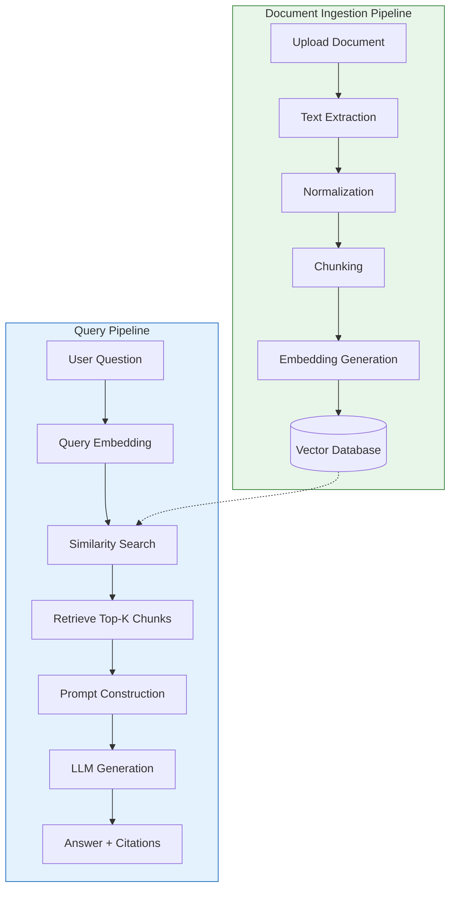

# AIRAG - Learning-Driven RAG Application

> **A Retrieval-Augmented Generation application built as a structured learning journey.**  
> This project serves both as a portfolio-quality RAG system and a comprehensive educational resource for understanding the architecture, concepts, and implementation of modern RAG pipelines.

---

## Project Overview

AIRAG (AI Retrieval-Augmented Generation) is a personal knowledge base and document question-answering system. It enables users to upload documents (PDF, Markdown, TXT, DOCX), process them into searchable chunks, and ask natural-language questions that are answered using only the information contained in the uploaded documents.

**Current Status:** Phase 1 – Understanding RAG Concepts ✅ **Complete** | Phase 2 – Document Ingestion 🔄 **In Progress** (all steps 2.1–2.5 and 2.6.1–2.6.2 complete and tested; next: 2.6.3 metrics). See **Complete Development Roadmap** below for the path to production readiness.

---

## Project Goals and Learning Objectives

### Software Engineering Goals
- Build a functional, maintainable, and portfolio-quality RAG application
- Follow professional software engineering practices (clean code, testing, documentation, Git workflows)
- Design for extensibility: modular architecture supporting future enhancements

### Learning Objectives
- **Understand** the theoretical foundations: LLMs, Transformers, tokens, embeddings, vector search
- **Implement** each RAG component from first principles before adopting libraries
- **Evaluate** trade-offs between chunking strategies, embedding models, retrieval parameters
- **Debug** and **optimize** the pipeline through experimentation
- **Document** decisions and learnings for future reference

---

## Key Features
 
| Feature | Status | Description |
|---------|--------|-------------|
| Document upload (PDF, MD, TXT, DOCX) | 🔄 Partial | Loaders + factory implemented; HTTP upload endpoint planned (Phase 8) |
| Text extraction & normalization | ✅ Implemented | Metadata preserved, encoding/whitespace normalized, errors wrapped |
| Recursive directory ingestion & CLI | ✅ Implemented | Discovery, hash deduplication, full pipeline `ingest`, JSON/human output |
| Configurable text chunking | ✅ Implemented | Fixed-size, sentence-aware and semantic strategies; strategy comparison partly documented |
| Embedding generation | 🔄 Partial | `EmbeddingService` with batch/cache/retry; model comparison not yet implemented |
| Vector database (ChromaDB) | 🔄 Partial | Idempotent writer implemented; retrieval/CRUD service not yet implemented |
| Semantic retrieval | 📋 Planned | Demo scripts only; no production `Retriever` with top-k/thresholds/evaluation |
| LLM integration (Ollama) | 📋 Planned | Local LLM, prompt construction, source attribution |
| FastAPI REST API | 📋 Planned | Document management, Q&A endpoints, OpenAPI docs |
| Conversation history | 📋 Planned | Multi-turn dialogue support |
| React frontend | 📋 Planned | Document UI, chat interface, citations |
| Advanced RAG (reranking, hybrid search, etc.) | 📋 Planned | Phase 10+ enhancements |
| Production readiness (Docker, monitoring, security) | 📋 Planned | Phase 11+ |

**Legend:** ✅ Implemented | 🔄 In Progress | 📋 Planned | 🚫 Not Started

---

## Technology Stack

### Backend
| Component | Technology | Version | Purpose |
|-----------|------------|---------|---------|
| API Framework | **FastAPI** | 0.162.2 | High-performance async REST API with automatic OpenAPI docs |
| Data Validation | **Pydantic** | 2.14.3 | Type-safe request/response models |
| Settings Management | **Pydantic-Settings** | 2.16.2 | Environment-based configuration |
| ASGI Server | **Uvicorn** | 0.54.0 | Production-grade async server |

### Document Processing
| Format | Library | Version |
|--------|---------|---------|
| PDF | **PyMuPDF (fitz)** | 1.28.2 |
| DOCX | **python-docx** | 1.2.0 |
| Markdown/TXT | **markdown** | 3.11.3 |

### RAG & AI
| Component | Technology | Version | Notes |
|-----------|------------|---------|-------|
| Embeddings | **Sentence Transformers** | 6.2.0 | `all-MiniLM-L6-v2` (384-dim, CPU-friendly) |
| ML Backend | **PyTorch** | 2.15.0 | CPU build (no CUDA required) |
| Transformers | **HuggingFace Transformers** | 5.22.2 | Model utilities, tokenizers |
| Acceleration | **Accelerate** | 1.15.0 | Optimized inference |
| Vector DB | **ChromaDB** | 1.5.9 | Local, persistent, no separate server needed |
| Local LLM | **Ollama** | 0.6.3 | `llama3.2:3b` or `phi3:mini` for 8GB VRAM |
| HTTP Client | **HTTPX** | 0.28.1 | Async requests for LLM APIs |
| LLM Abstraction | Custom interface | — | Swappable: Ollama, OpenAI, Anthropic, etc. |

### Development & Infrastructure
| Tool | Purpose |
|------|---------|
| **pytest** | Unit & integration testing (dev dependency) |
| **Docker / Docker Compose** | Containerization (planned) |
| **python-dotenv** | Environment variable management |
| **Git / GitHub** | Version control, CI/CD ready |
| **Ruff** | Linting & formatting (dev dependency) |
| **MyPy** | Type checking (dev dependency) |

### Frontend (Future)
- **React** (TypeScript) – Phase 9+

---

## High-Level RAG Architecture



### Component Interaction

```
┌─────────────────────────────────────────────────────────────────┐
│                        AIRAG APPLICATION                        │
├─────────────────────────────────────────────────────────────────┤
│  ┌──────────────┐  ┌──────────────┐  ┌──────────────┐          │
│  │   Ingestion  │  │   Retrieval  │  │  Generation  │          │
│  │   Service    │──▶│   Service    │──▶│   Service    │          │
│  └──────────────┘  └──────────────┘  └──────────────┘          │
│         │                │                │                      │
│         ▼                ▼                ▼                      │
│  ┌──────────────┐  ┌──────────────┐  ┌──────────────┐          │
│  │ Document     │  │ Vector Store │  │ LLM Provider │          │
│  │ Loaders      │  │ (ChromaDB)   │  │ (Ollama/API) │          │
│  └──────────────┘  └──────────────┘  └──────────────┘          │
└─────────────────────────────────────────────────────────────────┘
```

---

## How RAG Works: The Pipeline

### 1. Document Ingestion
```
Document → Extract Text → Normalize → Chunk → Embed → Store in Vector DB
```
- **Extraction**: Pull raw text + metadata (page numbers, headers) from files
- **Normalization**: Clean whitespace, fix encoding, standardize formatting
- **Chunking**: Split into overlapping segments (e.g., 500 tokens, 50 overlap)
- **Embedding**: Convert each chunk to a dense vector (semantic representation)
- **Storage**: Persist vectors + chunk text + metadata in ChromaDB

### 2. Query Processing
```
Question → Embed → Vector Search → Retrieve Top-K → Build Prompt → Generate Answer
```
- **Query Embedding**: Same model as document embeddings for semantic alignment
- **Similarity Search**: Cosine similarity in vector space finds relevant chunks
- **Context Assembly**: Combine retrieved chunks into structured prompt
- **Grounded Generation**: LLM answers using ONLY provided context
- **Attribution**: Return answer with source document + chunk references

### Key Principle: Grounding
> The LLM **must not** use parametric knowledge. Answers come exclusively from retrieved documents. When context is insufficient, the system explicitly states this.

---

## Project Roadmap and Development Phases

### Phase 0 – Project Foundation ✅ **Complete**
- [x] Repository initialized with Git remote (`origin` → GitHub)
- [x] Architecture planned and documented
- [x] Technology stack selected and documented
- [x] Python environment setup (Python 3.15.2, `.venv` virtual environment)
- [x] Dependency management (`pyproject.toml` + `requirements.txt` with pinned versions)
- [x] `.gitignore` configured (Python, IDE, OS, ML artifacts, HuggingFace cache)
- [x] `.env.example` created with all configuration options
- [x] Development conventions documented in README
- [x] Source package scaffold: `src/airag/` with `__init__.py`, `config.py`, `core/`
- [x] Tests directory created: `tests/`
- [x] All core dependencies installed and verified (70+ packages via Tsinghua mirror)
- [x] Configuration system: Pydantic Settings loading from `.env` with validation

> **Note on Python 3.15 + onnxruntime:** ChromaDB 1.5.9 requires `onnxruntime` which has no wheel for Python 3.15 yet. **Workaround**: Use `SentenceTransformerEmbeddingFunction` (our intended architecture) instead of ChromaDB's default ONNX embedder. Verified working.

### Phase 1 – Understanding RAG Concepts ✅ **Complete**
*Before coding: interactive learning sessions with code demonstrations*
- What are LLMs, Transformers, tokens?
- What are embeddings and vector space?
- Semantic search vs keyword search
- Vector databases and ANN algorithms
- Complete RAG pipeline walkthrough

### Phase 2 – Document Ingestion 🔄 **In Progress**
- [x] Multi-format loaders: PDF, DOCX, Markdown, TXT (factory-based extension routing)
- [x] Metadata extraction: source, page count, format, dates, encoding, structure
- [x] Error handling for corrupted, encrypted and unsupported files
- [x] `ExtractedDocument` / `LoadResult` models with SHA-256 content hash and timestamps
- [x] Recursive directory ingestion service with content deduplication
- [x] CLI: `python -m src.airag.ingestion.cli {directory,files,extensions,ingest}`
- [x] Unit tests for loaders, factory, models, service, CLI, exceptions and logging (415 passing)
- [x] Chunking contract (step 2.3.1: `Chunker` / `ChunkConfig` / `Chunk`)
- [x] Fixed-size chunking (step 2.3.2: char/token aware, page-preserving)
- [x] Sentence-aware chunking (step 2.3.3: boundaries, abbreviations, overlap)
- [x] Semantic chunking (step 2.3.4: embedding-similarity boundaries)
- [x] Embedding service (step 2.4.1: batched, cached, retry/backoff)
- [x] Vector store writer (step 2.4.2: batched upsert, idempotent by hash)
- [x] Chunk → embedding → document ID pipeline (step 2.4.3)
- [x] Full `IngestionPipeline` orchestrator (step 2.5.1)
- [x] YAML/JSON config + CLI wired to the orchestrator (step 2.5.2)
- [x] Progress reporting and checkpoint resume (step 2.5.4)
- [x] Exception hierarchy finalized (step 2.6.1)
- [x] Structured JSON logging with correlation IDs (step 2.6.2)
- [ ] Metrics and DLQ (steps 2.6.3–2.6.4) — **next**

> **Roadmap note:** the phase headings below are the original learning-journey
> numbering. Chunking (Phase 3), embeddings (Phase 4) and vector storage
> (Phase 5) are tracked in this project as Phase 2 steps **2.3** and **2.4**.
> The detailed section after Phase 11 is authoritative for step numbers,
> file outputs, coverage targets and acceptance criteria.

### Phase 3 – Text Chunking ✅ *(tracked as Phase 2 step 2.3 — implemented)*
- Configurable chunk size / overlap
- Strategies: fixed-size, sentence-aware, semantic
- Metadata propagation to chunks
- Visualization of chunk boundaries

### Phase 4 – Embeddings ✅ *(tracked as Phase 2 step 2.4.1 — implemented)*
- Sentence Transformers integration
- Model comparison (MiniLM, MPNet, E5, BGE)
- Batch embedding generation
- Dimension and similarity metric analysis

### Phase 5 – Vector Database 🔄 *(tracked as steps 2.4.2–2.4.4; writer implemented, retrieval pending)*
- ChromaDB setup (persistent client)
- Collection management
- CRUD operations for documents/chunks
- Similarity search with filters

### Phase 6 – Retrieval Pipeline 📋
- Query preprocessing
- Top-k retrieval with thresholds
- Retrieval evaluation (precision/recall concepts)
- Metadata filtering

### Phase 7 – LLM Integration & Generation 📋
- Ollama client wrapper
- Prompt templates (system, user, context)
- Streaming responses
- Source citation formatting
- "I don't know" handling

### Phase 8 – Complete RAG API 📋
- FastAPI application structure
- REST endpoints: documents, queries, health
- OpenAPI/Swagger documentation
- Integration tests
- Error handling & validation

### Phase 9 – Frontend 📋
- React + TypeScript setup
- Document upload & management UI
- Chat interface with citations
- Conversation history panel

### Phase 10 – Advanced RAG 📋
- Hybrid search (BM25 + vector)
- Reranking (cross-encoders)
- Query rewriting / multi-query
- Parent-child chunking
- Agentic RAG patterns

### Phase 11 – Production Readiness 📋
- Docker multi-stage builds
- Structured logging (structlog)
- Configuration management (pydantic-settings)
- Security (input validation, rate limiting)
- Monitoring (Prometheus/Grafana hooks)
- Deployment documentation

### Phase 2 – Detailed Implementation Plan (authoritative)

Source of truth: `E:\projects\airag_phase2_planning.md` (kept outside the repo).
This section mirrors that plan and adds live status; use **these** step IDs,
output paths and targets when choosing the next development task.

**Strategy:** modular, test-first, configurable, observable — loader abstraction
→ metadata → chunking → embedding/vector store → orchestration/CLI → errors/logging.

#### 2.1 Loader abstraction & factory

| Step | Description | Output | Status |
|------|-------------|--------|--------|
| 2.1.1 | `DocumentLoader` abstract base class | `loaders/base.py` | ✅ |
| 2.1.2 | `PDFLoader` (PyMuPDF) | `loaders/pdf.py` | ✅ |
| 2.1.3 | `DocxLoader`, `MarkdownLoader`, `TextLoader` | `loaders/*.py` | ✅ |
| 2.1.4 | `LoaderFactory` (extension → loader) | `factory.py` | ✅ |

#### 2.2 Text extraction & metadata

| Step | Description | Output | Status |
|------|-------------|--------|--------|
| 2.2.1 | `ExtractedDocument` dataclass | `models.py` | ✅ |
| 2.2.2 | PDF metadata: page count, title, author, dates | `pdf.py::extract_metadata()` | ✅ |
| 2.2.3 | DOCX metadata: core + custom properties | `docx.py::extract_metadata()` | ✅ |
| 2.2.4 | Markdown metadata: frontmatter, heading hierarchy | `markdown.py::extract_metadata()` | ✅ |
| 2.2.5 | Text metadata: encoding, line/char counts | `text.py::extract_metadata()` | ✅ |

#### 2.3 Chunking strategies

| Step | Description | Output | Status |
|------|-------------|--------|--------|
| 2.3.1 | `Chunker` protocol + `ChunkConfig` dataclass | `chunking/base.py` | ✅ (includes `Chunk` value object) |
| 2.3.2 | `FixedSizeChunker` (size + overlap, char/token aware) | `chunking/fixed.py` | ✅ (100% coverage) |
| 2.3.3 | `SentenceAwareChunker` (sentence boundaries + overlap) | `chunking/sentence.py` | ✅ (100% coverage; see deviation note) |
| 2.3.4 | `SemanticChunker` (embedding-based boundaries) | `chunking/semantic.py` | ✅ (100% coverage) |

#### 2.4 Embedding & vector store integration

| Step | Description | Output | Status |
|------|-------------|--------|--------|
| 2.4.1 | `EmbeddingService` (batched, cached, retry) | `embedding.py` | ✅ (100% coverage) |
| 2.4.2 | `VectorStoreWriter` (upsert by content hash) | `vector_store.py` | ✅ (100% coverage) |
| 2.4.3 | Chunk → embedding → document ID pipeline | `pipeline.py` (`EmbeddingPipeline`) | ✅ (100% coverage) |
| 2.4.4 | Idempotent write: hash → skip if exists | `vector_store.py` | ✅ (skip-if-unchanged implemented in 2.4.2) |

#### 2.5 Orchestration & CLI

| Step | Description | Output | Status |
|------|-------------|--------|--------|
| 2.5.1 | `IngestionPipeline` (load → extract → chunk → embed → store) | `pipeline.py` | ✅ (full orchestrator; 100% coverage) |
| 2.5.2 | CLI: `airag ingest <path> [--recursive] [--config]` | `cli/ingest.py` | ✅ (as `ingestion/cli.py`, full pipeline wired) |
| 2.5.2* | YAML/JSON config for chunking/embedding/loaders | `config/ingestion.yaml` | ✅ (`ingestion/config.py` + sample file) |
| 2.5.4 | Progress reporting (tqdm), resume/checkpoint | `pipeline.py` | ✅ (`CheckpointManager` + `TqdmProgress`, 100% coverage) |

> There is **no step 2.5.5** in the source plan. Directory traversal is a
> 2.5.1 responsibility; the existing service/CLI are documented against 2.5.1/2.5.2.

#### 2.6 Error handling & observability

| Step | Description | Output | Status |
|------|-------------|--------|--------|
| 2.6.1 | Exception hierarchy (`LoadError`, `ChunkError`, `EmbeddingError`) | `exceptions.py` | ✅ (finalized, 100% coverage) |
| 2.6.2 | Structured logging (JSON, correlation IDs) | `logging.py` | ✅ (100% coverage, CLI wired) |
| 2.6.3 | Metrics: files, chunks, latency | `metrics.py` | 📋 |
| 2.6.4 | Dead letter queue: failed files → retry / review | `pipeline.py` | 📋 |

#### Testing framework and targets

| Module | Target coverage | Current |
|--------|-----------------|---------|
| `loaders/pdf.py` | 90% | 92% |
| `loaders/docx.py` | 90% | 100% |
| `loaders/markdown.py` | 90% | 95% |
| `chunking/base.py` | — (contract; not in plan table) | 100% |
| `chunking/fixed.py` | 95% | 100% |
| `chunking/sentence.py` | 85% | 100% |
| `chunking/semantic.py` | 80% | 100% |
| `embedding.py` | 90% | 100% |
| `exceptions.py` | — (not in plan table) | 100% |
| `logging.py` | — (not in plan table) | 100% |
| `vector_store.py` | 95% | 100% |
| `pipeline.py` | — (2.4.3/2.5.1/2.5.4; not in plan table) | 100% |
| `config.py` | — (2.5.2; not in plan table) | 100% |
| `cli.py` | — (2.5.2; not in plan table) | 98% |

Integration scenarios (8): PDF→chunks→embeddings→ChromaDB; DOCX tables/images;
50-page PDF streaming; corrupted PDF → `LoadError`+DLQ; duplicate file → idempotent
upsert; recursive mixed-format directory; config override (`--chunk-size 500`);
resume after interrupt.
E2E scenarios (3): full ingest→query→answer with citations; incremental update;
metadata filtering.

Test layout: `tests/unit/` (loader, factory, model, service, CLI tests) plus
`tests/unit/ingestion/chunking/` for the 2.3.x contract and strategies, with
`tests/integration/`, `tests/e2e/` and binary `tests/fixtures/` still planned —
generate small fixtures in `tmp_path` instead of committing binaries.

CI/CD gates (from the plan): `pytest tests/unit -x --cov=src/airag/ingestion
--cov-fail-under=85`; `pytest tests/integration -x --timeout=120`; `pytest tests/e2e
-x --timeout=300`; `ruff src/ tests/`; `mypy src/airag/ingestion`. The whole-tree
ruff gate currently has pre-existing debt in `test_pdf.py` and a few loader files.

#### Milestones

| Week | Focus | Deliverable | Status |
|------|-------|-------------|--------|
| 1 | Loaders + factory | All 4 loaders working, factory tested | ✅ |
| 2 | Chunking + metadata | 3 chunkers, full metadata extraction | ✅ (chunkers done; `section` metadata open) |
| 3 | Embedding + vector store | Batched embedding, idempotent ChromaDB writes | ✅ (services done; retrieval in Phase 6) |
| 4 | Pipeline + CLI + tests | End-to-end ingest, full test suite green | ✅ (orchestrator, CLI, config, checkpoint done) |

#### Definition of Done (Phase 2)

- [x] All 4 loaders handle varied test files without crashes
- [x] Chunking strategies produce correct overlap/size (fixed/sentence/semantic unit tests)
- [ ] Metadata includes: source, page, section, hash, timestamps (`section` not yet defined)
- [x] Idempotent: re-ingest same dir → 0 new chunks (orchestration test + live ChromaDB smoke)
- [x] Resume: interrupt between documents → restart completes (per-document checkpoint, two-run smoke)
- [ ] Observability: JSON logs, Prometheus metrics exposed
- [x] Coverage ≥85% unit (current: 99% ingestion, 387 tests)
- [ ] Documentation: `docs/INGESTION.md` with config examples

#### Step 2.3.1 decisions (resolved)

1. `Chunk` lives in `chunking/base.py` — the only output file named by 2.3.1; `models.py` stays the extracted-document model.
2. `Chunker.chunk(document: ExtractedDocument) -> list[Chunk]` so source/page/hash/timestamps propagate.
3. `ChunkConfig` = frozen/slotted `chunk_size`, `overlap`, `length_unit` (`char`|`token`); invalid values raise `ChunkError`.
4. `Chunk` = frozen/slotted `text`, `metadata`, `chunk_index`, `start_char`, `end_char`; no new dependencies.
5. `Chunker` is a `@runtime_checkable` `typing.Protocol`, not an ABC.

#### Step 2.3.2 decisions (resolved)

1. Both length units implemented now: character windows and token windows via tiktoken (`cl100k_base`).
2. `tiktoken>=0.14.0` declared in `pyproject.toml`; the existing `tiktoken==0.14.0` pin in `requirements.txt` retained (comment updated).
3. Page boundaries respected: each `ExtractedDocument.pages` entry is chunked independently, with a 1-based `page` metadata key and offsets into the full document text.
4. Chunk metadata carries inherited `source`/`format` plus `hash`, `ingested_at`, `chunk_index`, `page`, `start_char`, `end_char`.
5. Token offsets reconstructed from `decode_tokens_bytes`, so `text[start_char:end_char]` always matches the chunk text. Tokenizer is injectable for deterministic tests.

#### Step 2.3.3 decisions (resolved)

1. **Deviation from plan wording:** the plan says "spaCy / NLTK boundaries", but neither library is installed or declared and both require model downloads. The default splitter is a dependency-free regex that handles `.`, `!`, `?`, ellipses and CJK/Arabic end punctuation, with abbreviation and initial merging.
2. An NLTK/spaCy-style `Callable[[str], list[str]]` can be injected via `sentence_splitter`; sentence strings are mapped back to offsets in the source text.
3. `chunk_size`/`overlap` count characters by default, or tokens with `length_unit="token"` (tiktoken, injectable). Overlap re-includes trailing whole sentences, never cutting one in half.
4. Page boundaries, offsets and metadata use the shared helpers added to `chunking/base.py`, so fixed and sentence chunkers produce identical metadata shapes.

#### Step 2.3.4 decisions (resolved)

1. Since 2.4.1's `EmbeddingService` is not implemented, the embedder is injectable; the default lazily loads `SentenceTransformer("all-MiniLM-L6-v2")` on first use (may download weights if not cached). Tests inject deterministic embeddings, so no model download occurs.
2. Boundary policy: cosine similarity between adjacent sentence embeddings below `threshold` (default `0.75`) starts a new chunk; `chunk_size` is a hard cap and can force an earlier boundary.
3. `ChunkConfig.overlap` is deliberately ignored here — re-including tail sentences would blur the semantic boundary just detected.
4. Sentence spans and page/metadata helpers are shared with the sentence chunker; all three strategies emit the identical `Chunk` shape.

#### Step 2.4.1 decisions (resolved)

1. `EmbeddingService` owns the lazy `SentenceTransformer` loading; `SemanticChunker` was left unchanged. Its `embedder` parameter accepts the service directly via `EmbeddingService.__call__`, so no duplicate model loading or code churn.
2. Batching deduplicates texts per call (`batch_size` default 32). Caching is an LRU keyed by exact text (`cache_size` default 1024, `0` disables), with `clear_cache()` for lifecycle control.
3. Retry: `max_retries` retries after the first failure (default 3), exponential backoff `retry_backoff * 2**attempt` (base 0.5s), with an injectable sleep function. Validation errors are not retried.
4. All failures use `EmbeddingError`; vector count, numeric validity and consistent dimension are enforced.

#### Step 2.4.2 decisions (resolved)

1. Collection `airag_chunks` by default; ChromaDB client/collection are injectable. Default uses `EphemeralClient()` unless `persist_directory` is given, then `PersistentClient(path=...)` — no server required.
2. Upsert ID is `<document hash>:<chunk_index>` (document hash comes from chunk metadata, auto-computed by `models.py` otherwise). A `chunk_hash` (SHA-256 of chunk text) is stored in metadata: unchanged chunks are skipped, changed text is updated. This covers 2.4.4's idempotency primitive.
3. Batch writes with per-batch existence lookup; metadata is sanitized for ChromaDB (drop `None`, JSON-stringify nested values), keeping all chunk fields as payload (no filter schema yet).
4. All store failures use `IngestionError`; `WriteResult` reports `written`/`updated`/`skipped` and the affected IDs.

#### Step 2.4.3 decisions (resolved)

1. `pipeline.py` hosts the narrow `EmbeddingPipeline`; step 2.5.1's broader `IngestionPipeline` will be added alongside it and call it, avoiding a name collision.
2. Chunks are grouped by stable document ID (`VectorStoreWriter.document_id`), embedded once per document via `EmbeddingService.embed`, then stored via `VectorStoreWriter.write` — no duplicated batching/caching.
3. `PipelineResult` reports `processed/written/updated/skipped`, `document_ids` and every assigned `chunk_id`; domain errors propagate unchanged.

#### Step 2.5.1 decisions (resolved)

1. `IngestionPipeline` lives in `pipeline.py` beside `EmbeddingPipeline` and owns chunking; it composes `DocumentIngestionService`, a `Chunker`, `EmbeddingPipeline` and `VectorStoreWriter` via constructor injection (no hidden global defaults except an optional service).
2. Directory walking stays in `service.py` as a delegate: file paths route to `ingest_files([path])`, directories to `ingest_directory(path)`.
3. Per-file failure isolation records an error in `FileResult` and continues; a real dead letter queue remains 2.6.4, progress/resume remains 2.5.4.
4. `PipelineRunResult` aggregates files/succeeded/failed/chunks/written/updated/skipped; domain errors from stages are captured per file rather than aborting the run.

#### Step 2.5.2 decisions (resolved)

1. `ingest` was added to the existing `ingestion/cli.py` (not a new `src/airag/cli/ingest.py`) to preserve all existing subcommands; documented deviation from the plan's output path.
2. `IngestionConfig` in `ingestion/config.py` validates chunker/size/overlap/length unit, embedding batch/cache, vector collection/persistence and generic `loader_options`. YAML and JSON are supported, with a ruamel-shim fallback; sample at `config/ingestion.yaml`.
3. CLI flags (`--config`, `--chunker`, `--chunk-size`, `--overlap`, `--no-recursive`) override file values. Exit code is 0 only when at least one file succeeded or was resumed and none failed.
4. `loader_options` are forwarded from the service to `get_loader(path, **options)`; config building is lazy so no model weights load at parse time.

#### Step 2.5.4 decisions (resolved)

1. Checkpoints are a separate JSON file (opt-in via CLI `--checkpoint`), keyed by document `content_hash` so renames do not invalidate them; writes are atomic via a temp file and `replace`.
2. `NullProgress` is the default (keeps JSON output clean); `TqdmProgress` is opt-in via `--progress` and writes to stderr. Both use `start`/`advance`/`finish`, with `finish` in a `finally` block.
3. Resume skips documents already marked complete at the file level; unchanged chunks are still skipped by `chunk_hash` in the vector store, so both layers compose.
4. `PipelineRunResult.resumed` and `FileResult.resumed` report skips; CLI exit code counts resumed as success when no file failed.

#### Step 2.6.1 decisions (resolved)

1. `UnsupportedFormatError` stays under `LoadError` — the factory raises it and `DocumentIngestionService` catches it as a load failure; changing that would break existing behaviour.
2. Added `VectorStoreError` and `PipelineError` as siblings under `IngestionError`; vector-store and service raises now use them instead of the generic base.
3. Factory registration errors remain `TypeError`/`ValueError` (programming errors). Chunkers keep raising `ChunkError` for tokenization/embedding failures inside their stage; standalone `EmbeddingService` keeps `EmbeddingError`.
4. HTTP status mapping is deferred to Phase 8, where endpoint semantics can be decided; no speculative status codes were added.

#### Step 2.6.2 decisions (resolved)

1. Used `python-json-logger` (already declared) instead of a custom stdlib formatter; all modules keep `logging.getLogger(__name__)`.
2. Correlation IDs live in a `ContextVar`, generated once per CLI invocation and attached by a handler filter; they are not added to `LoadResult`/`FileResult` output.
3. `--log-level` is a global CLI argument; `Settings.log_level` stays in `src/airag/config.py` for now. The duplicate-settings question remains tracked but is not blocking this step.
4. Logs go to stderr only; sensitive `extra` fields are masked. A live `directory` smoke produced JSON records with a shared correlation ID and clean human-readable stdout.

#### Next step: 2.6.3 — metrics

Open decisions for the next step:
1. Registry location: a new `metrics.py` with an in-process `MetricsRegistry` versus `prometheus-client` (not currently a dependency).
2. Which counters/histograms to expose first: files/chunks written/skipped/failed and load/chunk/embed/store latency.
3. Whether metrics are reset per CLI run or accumulated, and how they will be read from the future FastAPI endpoint.
4. Deferred: 2.6.4 DLQ, API-boundary log configuration, and `section` derivation for non-markdown formats.

## Complete Development Roadmap (Verified Status → Production Ready)

### Status legend

✅ Completed · 🔄 Partially implemented / in progress · 📋 Planned · 🚫 Missing / not defined · ⚠️ Needs improvement

### Verified current state (2026-11-27)

- Last committed snapshot: `8a7baf4 feat(ingestion): finalize exception hierarchy (step 2.6.1)`; 2.6.2 is implemented locally but not yet committed/pushed.
- Tests: **415 passing**, ingestion coverage **99%**; ruff and mypy clean on touched files.
- Production code exists **only** in `src/airag/config.py` and `src/airag/ingestion/**`. A structured logging module (`logging.py`) now exists; there is still no metrics, DLQ, API, retrieval, generation or frontend module.
- `demo/session_1_*.py` are learning scripts with model-free self-tests; they are not production services.
- `docs/ARCHITECTURE.md`, `DECISIONS.md`, `LEARNING_ROADMAP.md`, `RAG_CONCEPTS.md` contain substantial drafts (1,210 lines total), not placeholders. `docs/DEVELOPMENT_LOG.md` and `docs/API.md` do not exist.

### Gap analysis

| Category | Items | Evidence / notes |
|----------|-------|------------------|
| ✅ Completed | Phases 0–1; Phase 2 steps 2.1.1–2.5.4 and 2.6.1–2.6.2 | Loaders, factory, models, metadata, 3 chunkers, embedding service, vector writer, pipelines, CLI, config, progress/checkpoint, finalized exceptions, structured JSON logging; all unit-tested |
| 🔄 Partial | 2.6.3–2.6.4 metrics and DLQ | Modules use `logging.getLogger` with JSON config at CLI boundary; `FileResult.error` is a DLQ primitive only |
| 📋 Planned | Retrieval service, generation service, FastAPI, frontend, advanced RAG, production readiness | Existing README Phases 6–11; no source modules yet |
| 🚫 Missing | `metrics.py`, DLQ, `docs/INGESTION.md`, `docs/API.md`, `docs/DEVELOPMENT_LOG.md`, `LICENSE`, `.github/` CI, `Dockerfile`, `docker-compose.yml`, `scripts/`, integration/E2E tests | Verified by file listing |
| ⚠️ Needs improvement | Whole-tree ruff debt, stale README statuses, duplicate chunk-size settings, model-download strategy, empty `src/airag/core/`, stray `pyproject.toml.bak` | See “Known issues and technical debt” below |

### Phase sequence overview

| Stage | Phase | Objective | Depends on | Status |
|-------|-------|-----------|------------|--------|
| A | 2.6 | Error handling, observability, failure recovery | Phase 2 ingestion (done) | 🔄 In Progress (2.6.1–2.6.2 done) |
| B | 6 | Retrieval service over stored chunks | A (errors/metrics), vector store | 📋 |
| C | 7 | Grounded answer generation with citations | B, embedding model, Ollama | 📋 |
| D | 8 | FastAPI REST API exposing ingestion + Q&A | A–C | 📋 |
| E | 9 | React frontend | D | 📋 |
| F | 10 | Advanced RAG (hybrid, rerank, rewrite, parent-child) | B–D + evaluation harness | 📋 |
| G | 11 | Production readiness (security, deploy, ops, docs) | A–E | 📋 |

Cross-cutting work (documentation, integration/E2E tests, CI) advances with every stage; it is not deferred to the end.

---

### Stage A — Phase 2.6: Error handling & observability 🔄 **In Progress**

**Objective:** make failures typed, visible and recoverable before adding online query/generation paths.

**Scope:** `exceptions.py`, new `logging.py` / `metrics.py`, DLQ in `pipeline.py`, CLI/API error boundaries.

**Implementation tasks**
- [x] 2.6.1 Finalize exception hierarchy: removed `TODO(2.6.1)`; added `VectorStoreError` and `PipelineError` under `IngestionError`; existing error behaviour unchanged. HTTP status mapping deferred to Phase 8.
- [x] 2.6.2 Structured logging: `logging.py` with a JSON formatter (`python-json-logger`) and correlation-ID `ContextVar`; configured once at the CLI boundary via global `--log-level`; stderr only, sensitive `extra` fields redacted; module-level `getLogger(__name__)` calls unchanged.
- [ ] 2.6.3 Metrics: counters for files/chunks written/skipped/failed, latency histograms for load/chunk/embed/store, in-memory registry with a future HTTP endpoint.
- [ ] 2.6.4 Dead letter queue: append failed files (path, error, timestamp, hash) to a JSONL DLQ; expose retry/review list; wire to `FileResult.error`.

**Technical considerations:** use stdlib `logging` + `python-json-logger` (already declared); no new heavy dependency; correlation IDs must survive CLI and future async API paths.

**Dependencies:** Phase 2 ingestion code (done). Blocks metric endpoints in Phase 8 and retry UX in Phase 9.

**Deliverables:** `exceptions.py` final, `logging.py`, `metrics.py`, DLQ support in `pipeline.py`, `tests/unit/test_logging.py`, `test_metrics.py`, updated exception tests.

**Acceptance criteria:** no `TODO(2.6.1)` remains; one JSON log line per processed file with a correlation ID; metrics counters match `PipelineRunResult`; failed file appears in DLQ and can be retried; all gates green.

**Testing:** unit tests for formatter/context, metric increments, DLQ round-trip; integration test with one corrupt PDF + one good TXT.

---

### Stage B — Phase 6: Retrieval service 📋

**Objective:** answer “which stored chunks are relevant to this question?” with measurable quality.

**Scope:** `src/airag/retrieval/` — protocol, Chroma implementation, query preprocessing, evaluation.

**Implementation tasks**
- [ ] 6.1 `Retriever` protocol and `RetrievalResult` (chunk text, score, source/page/section metadata).
- [ ] 6.2 `ChromaRetriever`: query embedding via `EmbeddingService`, top-k, `score_threshold`, metadata filters (`source`, `format`, `page`), collection/persist path from config.
- [ ] 6.3 Query preprocessing: whitespace normalization, optional expansion; length guard against embedding model token limit.
- [ ] 6.4 Retrieval evaluation harness: recall@k / precision@k / MRR on a small labelled query set committed as text fixtures.
- [ ] 6.5 Config wiring: retrieval section in `IngestionConfig` or a shared app settings module (resolve the duplicate-settings issue first).

**Dependencies:** Stage A metrics/errors; vector store and embedding service (done). Blocks Stage C and API query endpoint.

**Deliverables:** `retrieval/base.py`, `chroma.py`, `evaluation.py`, `tests/unit/test_retrieval.py`, `tests/fixtures/queries.jsonl`.

**Acceptance criteria:** given an ingested corpus, a known query returns the expected chunk in top-k; metadata filters reduce results correctly; evaluation command prints recall@k and MRR; no results → empty list, not an exception.

**Testing:** unit with a fake collection; integration with real ChromaDB ephemeral and injected embeddings; quality regression test on the labelled fixture set.

---

### Stage C — Phase 7: LLM integration & generation 📋

**Objective:** produce grounded answers with citations, or explicitly refuse when context is insufficient.

**Scope:** `src/airag/generation/` — Ollama client, prompts, context assembly, grounding gate, streaming.

**Implementation tasks**
- [ ] 7.1 `OllamaClient`: async wrapper over `ollama`/`httpx`, model from config, timeouts, retries with backoff, typed errors.
- [ ] 7.2 Prompt templates: system prompt enforcing “use only context”, user/context template, citation format (`[source, page]`).
- [ ] 7.3 Context assembler: top-k retrieval results → deduplicated, token-budgeted context block.
- [ ] 7.4 Grounding gate: if best score < threshold or no chunks → return “I don't know” without calling the LLM.
- [ ] 7.5 Streaming API and non-streaming path; map provider errors to Stage A exception hierarchy.

**Dependencies:** Stage B retriever, Ollama installed locally for manual checks; tests use a fake client.

**Deliverables:** `generation/client.py`, `prompts.py`, `service.py`, `tests/unit/test_generation.py`.

**Acceptance criteria:** answer text contains at least one valid citation when context is sufficient; insufficient context returns the refusal string and makes zero LLM calls; streaming yields incremental chunks; provider failure raises a typed error.

**Testing:** unit with fake client; prompt-injection regression tests; optional manual smoke with `llama3.2:3b`.

---

### Stage D — Phase 8: FastAPI RAG API 📋

**Objective:** expose ingestion and Q&A over HTTP with validated contracts and OpenAPI docs.

**Scope:** `src/airag/api/` — app factory, routers, schemas, error handlers, background ingest.

**Implementation tasks**
- [ ] 8.1 App factory + `Settings` validation; health (`/healthz`) and readiness (`/readyz`) endpoints.
- [ ] 8.2 `POST /documents` upload: file size/type validation, stream to `upload_dir`, enqueue `IngestionPipeline.ingest` as a background task, return job ID.
- [ ] 8.3 `GET /documents` and `GET /jobs/{id}` for status/DLQ entries; `DELETE /documents/{id}` with vector-store cleanup decision.
- [ ] 8.4 `POST /query`: Pydantic request/response models, call retriever + generation service, return answer + citations + scores.
- [ ] 8.5 Error handlers mapping `IngestionError` subclasses to HTTP 400/404/409/422/503; correlation IDs from Stage A in response headers.
- [ ] 8.6 Integration tests with `httpx.ASGITransport`; OpenAPI/Swagger at `/docs`.

**Dependencies:** Stages A–C; Pydantic/FastAPI already installed. Blocks frontend and production deployment.

**Deliverables:** `api/main.py`, `api/routers/`, `api/schemas.py`, `tests/integration/test_api.py`.

**Acceptance criteria:** upload→query→answer-with-citations works end-to-end without model download in tests; invalid file returns 422; `/docs` renders; CI runs integration tests.

---

### Stage E — Phase 9: Frontend 📋

**Objective:** usable browser UI for document management and grounded chat.

**Scope:** `frontend/` React + TypeScript (Vite), API client, three screens.

**Implementation tasks**
- [ ] 9.1 Project scaffold, env-based API base URL, typed API client.
- [ ] 9.2 Document list/upload with progress and job status polling.
- [ ] 9.3 Chat interface rendering answer, clickable citations opening source text/page.
- [ ] 9.4 Conversation history panel persisted in browser storage.
- [ ] 9.5 Error/empty states and basic accessibility.

**Dependencies:** Stage D API contract. Deliverables: `frontend/`, `npm run dev` and build instructions.

**Acceptance criteria:** upload a PDF, ask a question, see answer with working citations; build passes; no secrets in frontend bundle.

---

### Stage F — Phase 10: Advanced RAG 📋

**Objective:** improve retrieval quality with measurable A/B comparisons, not by default complexity.

**Scope:** hybrid search, reranking, query rewriting, parent-child chunking, optional agentic patterns.

**Implementation tasks**
- [ ] 10.1 BM25 + dense hybrid retriever (`rank-bm25` already installed) with weighted fusion.
- [ ] 10.2 Cross-encoder reranker behind a feature flag; model choice documented.
- [ ] 10.3 Query rewriting / multi-query expansion with cache.
- [ ] 10.4 Parent-child chunking strategy implementing the same `Chunker` protocol.
- [ ] 10.5 Evaluation report comparing baseline vs. each strategy on the Stage B labelled set.

**Dependencies:** Stages B–D + evaluation harness. Acceptance: each strategy shows a measured gain or is disabled with rationale; no regression in baseline tests.

---

### Stage G — Phase 11: Production readiness 📋

**Objective:** make the application deployable, observable, secure and recoverable.

**Scope:** containers, configuration/secrets, security, performance, operations, documentation, release.

**Implementation tasks**
- [ ] 11.1 Multi-stage `Dockerfile` (build/test/runtime), `docker-compose.yml` for app + Chroma volume + Ollama, non-root user, healthchecks.
- [ ] 11.2 Secrets/config: `.env.example` complete; `pydantic-settings` validation at startup; no credentials in Git; document rotation.
- [ ] 11.3 Security: upload validation (extension allowlist, magic bytes, size cap), path-traversal checks, API-key/JWT auth, rate limiting.
- [ ] 11.4 Reliability: retries/backoff on external calls, DLQ replay, checkpoint backup/restore, ChromaDB backup procedure and restore drill.
- [ ] 11.5 Performance: verify embedding batch/cache settings, async API paths, p95 targets recorded in `docs/PERFORMANCE.md`.
- [ ] 11.6 CI/CD: `.github/workflows/ci.yml` running pytest + ruff + mypy + coverage gate; tagged releases and CHANGELOG.
- [ ] 11.7 Documentation: `docs/INGESTION.md`, `docs/API.md`, `docs/DEPLOYMENT.md`, `docs/RUNBOOK.md`, `docs/DEVELOPMENT_LOG.md`, updated ADRs, `LICENSE`.

**Acceptance criteria:** all items in the production-readiness checklist below are checked; `docker compose up` yields a healthy app; restore drill succeeds; CI passes; an on-call person can follow the runbook without asking the author.

---

### Production-readiness checklist

- [ ] Application starts from a clean checkout via documented commands; `/healthz` and `/readyz` return 200.
- [ ] No secrets or credentials in the repository; configuration validated at startup.
- [ ] Uploads validated by extension, magic bytes and size; path traversal rejected.
- [ ] Authentication and rate limiting enabled on all non-health endpoints.
- [ ] JSON logs with correlation IDs from Stage A; metrics endpoint exposes files/chunks/latency.
- [ ] Retries/backoff on Ollama and embedding calls; failures land in DLQ with replay path.
- [ ] ChromaDB data and checkpoint files have documented backup + tested restore.
- [ ] Integration, E2E and security tests pass in CI; unit coverage gate ≥85%.
- [ ] p95 query latency and ingestion throughput targets measured and documented.
- [ ] Deployment, operations and rollback runbooks exist; `LICENSE` and CHANGELOG present.

### Development sequence and next action

1. **Done → Stage A / 2.6.1:** finalized `exceptions.py` (no `TODO(2.6.1)`), added `VectorStoreError`/`PipelineError`, kept existing error behaviour, with tests and README updated.
2. **Done → 2.6.2 structured logging:** added `logging.py`, CLI `--log-level`, correlation IDs and redaction; 12 new tests.
3. **Now → 2.6.3 metrics**, then 2.6.4 DLQ in that order (metrics feed the future API endpoint).
4. Stage B retrieval → Stage C generation → Stage D API → Stage E frontend.
5. Stage F advanced RAG only after the Stage B evaluation harness exists; Stage G production readiness alongside D/E and before any real deployment.

**First actionable tasks for 2.6.3:** (a) choose the in-memory registry design; (b) instrument load/chunk/embed/store boundaries with counters and latency histograms; (c) add CLI summary output from the registry; (d) add tests proving counters reset per run.

### Known issues, risks and technical debt

- ⚠️ Whole-tree `ruff check src/airag/ingestion tests/unit` still reports pre-existing debt (duplicate test names in `test_pdf.py`, trailing-newline warnings, one `B904`); scoped gates pass.
- ⚠️ `section` metadata is undefined for non-markdown formats — DoD item deliberately unchecked.
- ⚠️ Two settings sources exist: `src/airag/config.py` (`chunk_size`, `embedding_model`) and `src/airag/ingestion/config.py`; decide a single source of truth before Stage B/8.
- ⚠️ The default `SentenceTransformer` embedder loads model weights lazily and may download them on first real use; no offline strategy is defined yet.
- ⚠️ Section 2.3.3 deviates from the plan by using a regex splitter instead of spaCy/NLTK (documented in decisions).
- 🚫 Missing: `LICENSE`, `.github/` CI, `docs/DEVELOPMENT_LOG.md`, `docs/API.md`, `docs/INGESTION.md`, integration/E2E tests, Docker files.
- ⚠️ `src/airag/core/` is empty; `pyproject.toml.bak` and `demo/output/**` generated databases should be reviewed for removal/gitignore.
- 📋 Open decisions needing clarification: retrieval/generation library choices, frontend stack confirmation, authentication model, deployment target, and whether to keep the learning-journey phase numbering or renumber around the implementation plan.

---

## Repository Structure

```
airag/
├── .github/                    # GitHub workflows, templates (future)
├── .kilo/                      # Kilo configuration
├── config/                     # Ingestion config sample (ingestion.yaml)
├── docs/                       # Documentation drafts
│   ├── ARCHITECTURE.md         # System architecture details (draft)
│   ├── LEARNING_ROADMAP.md     # Phase-by-phase learning guide (draft)
│   ├── RAG_CONCEPTS.md         # Core RAG theory explanations (draft)
│   ├── DECISIONS.md            # Architectural decision records (ADRs)
│   ├── DEVELOPMENT_LOG.md      # (planned)
│   └── API.md                  # (planned, Phase 8)
├── src/                        # Application source code
│   ├── airag/
│   │   ├── __init__.py         # Package init, exports settings
│   │   ├── config.py           # Pydantic Settings (loads .env, validates)
│   │   └── ingestion/          # Phase 2 document ingestion
│   │       ├── __init__.py     # Public ingestion API re-exports
│   │       ├── cli.py          # CLI: extensions / directory / files / ingest
│   │       ├── chunking/       # base.py, fixed.py, sentence.py, semantic.py
│   │       ├── config.py       # YAML/JSON IngestionConfig (2.5.2)
│   │       ├── embedding.py    # Batch/cache/retry embedding service (2.4.1)
│   │       ├── exceptions.py   # LoadError, UnsupportedFormatError, etc.
│   │       ├── factory.py      # Extension → loader registry
│   │       ├── models.py       # ExtractedDocument, LoadResult, IngestionResult
│   │       ├── pipeline.py     # EmbeddingPipeline + IngestionPipeline
│   │       ├── service.py      # Directory traversal + deduplication
│   │       ├── vector_store.py # Batched idempotent ChromaDB upserts (2.4.2)
│   │       └── loaders/        # base.py, pdf.py, docx.py, markdown.py, text.py
├── tests/                      # Test suite (repository root, not src/tests)
│   ├── unit/                   # 387 unit tests
│   ├── integration/            # (planned)
│   └── fixtures/               # (planned)
├── .env.example                # Environment template
├── .gitignore                  # Updated with ML/artifact patterns
├── pyproject.toml              # Project config, dependencies, tooling
├── requirements.txt            # Pinned dependencies (actual installed versions)
├── README.md                   # This file
└── LICENSE                     # MIT License (to be added)
```

> **Not yet created:** `docker/`, `scripts/`, `docker-compose.yml`, `Dockerfile`, `LICENSE`, `.github/workflows/`, `docs/DEVELOPMENT_LOG.md`, `docs/API.md`. `docs/` now exists with four drafts. `src/airag/core/` exists but is empty.

---

## Getting Started

### Prerequisites
- Python 3.10+ (tested on 3.15.2)
- Git
- (Optional) Docker & Docker Compose — for Phase 11+
- (For local LLM) [Ollama](https://ollama.ai) installed

### Quick Start (Verified)
```bash
# Clone repository
git clone https://github.com/alireza15bagheri/AIRAG.git
cd AIRAG

# Create virtual environment
python -m venv .venv
source .venv/bin/activate  # Windows: .venv\Scripts\activate

# Install dependencies (use Tsinghua mirror if PyPI is slow)
pip install -r requirements.txt
# Or: pip install --index-url https://pypi.tuna.tsinghua.edu.cn/simple -r requirements.txt

# Configure environment
cp .env.example .env
# Edit .env with your settings

# Verify installation
python -c "
import fastapi, uvicorn, pydantic, chromadb, sentence_transformers
import torch, transformers, ollama, httpx, fitz, docx, markdown
print('✅ All core packages import successfully')
"
```

### Document Ingestion CLI

The ingestion CLI exposes a load-only mode (`directory`/`files`) and a full
pipeline mode (`ingest`). All commands report per-file results and SHA-256
content hashes.

```bash
# List supported extensions
PYTHONPATH=src ./.venv/Scripts/python.exe -m src.airag.ingestion.cli extensions

# Full pipeline: load → chunk → embed → store, using config/ingestion.yaml
PYTHONPATH=src ./.venv/Scripts/python.exe -m src.airag.ingestion.cli \
  ingest path/to/docs --config config/ingestion.yaml -o results.json

# Override config values from the command line
PYTHONPATH=src ./.venv/Scripts/python.exe -m src.airag.ingestion.cli \
  ingest a.pdf b.md --chunker sentence --chunk-size 300 --overlap 30 -v

# Resume from an explicit checkpoint and show progress on stderr
PYTHONPATH=src ./.venv/Scripts/python.exe -m src.airag.ingestion.cli \
  ingest path/to/docs --checkpoint .airag_checkpoint.json --progress

# Load-only modes (no chunking/embedding)
PYTHONPATH=src ./.venv/Scripts/python.exe -m src.airag.ingestion.cli \
  directory path/to/docs -o load_report.json
PYTHONPATH=src ./.venv/Scripts/python.exe -m src.airag.ingestion.cli \
  files a.pdf b.md -v --fail-fast
```

`ingest` flags: `--config FILE` (YAML/JSON), `--chunker {fixed,sentence,semantic}`,
`--chunk-size N`, `--overlap N`, `--no-recursive`, `--checkpoint FILE` (resume),
`--progress` (tqdm on stderr), `-o FILE` and `-v`. A global `--log-level
{DEBUG,INFO,WARNING,ERROR,CRITICAL}` (before the subcommand) configures JSON logs
with a correlation ID on stderr; stdout stays machine-readable. It exits 0 only when at least
one file succeeded or was resumed and none failed. Load-only flags:
`--no-recursive`, `-e .txt .md`, `--no-deduplicate`, `--fail-fast`, `-o FILE`, `-v`.

### Hardware Considerations
| Component | Recommendation | Minimum |
|-----------|----------------|---------|
| RAM | 16 GB+ | 8 GB |
| GPU VRAM | 8 GB (AMD RX 5700 XT) | 4 GB |
| Storage | 10 GB free | 5 GB |
| CPU | Modern multi-core | 4 cores |

**Embedding Model:** `all-MiniLM-L6-v2` (384-dim, ~90 MB, runs on CPU)  
**Local LLM Options:** `llama3.2:3b` (~2 GB), `phi3:mini` (~2.3 GB), `gemma2:2b` (~1.6 GB)

---

## Learning Resources and Documentation

| Document | Purpose | Status |
|----------|---------|--------|
| [LEARNING_ROADMAP.md](docs/LEARNING_ROADMAP.md) | Step-by-step learning path with exercises | Substantial draft; needs status refresh |
| [RAG_CONCEPTS.md](docs/RAG_CONCEPTS.md) | Deep-dive into RAG theory and components | Substantial draft |
| [ARCHITECTURE.md](docs/ARCHITECTURE.md) | System design, data flows, component diagrams | Substantial draft; needs update for implemented ingestion stack |
| [DECISIONS.md](docs/DECISIONS.md) | Architectural Decision Records (ADRs) | Several ADRs recorded; extend with later decisions |
| DEVELOPMENT_LOG.md | Daily progress, blockers, solutions | 🚫 Not created |
| API.md | API documentation | 🚫 Not created (Phase 8) |
| INGESTION.md | Ingestion config and CLI guide | 🚫 Not created (Phase 11 docs task) |

### Recommended External Resources
- **Books:** *Building LLMs for Production* (Huyen), *Natural Language Processing with Transformers* (Tunstall et al.)
- **Papers:** "Attention Is All You Need" (Vaswani et al.), "Retrieval-Augmented Generation" (Lewis et al., 2020)
- **Courses:** Fast.ai Practical Deep Learning, Hugging Face NLP Course

---

## Testing

### Test Strategy
| Level | Scope | Tools |
|-------|-------|-------|
| Unit | Individual functions/classes | `pytest`, `pytest-mock` |
| Integration | Service interactions, API endpoints | `pytest`, `httpx` |
| E2E | Full pipeline (ingestion → answer) | `pytest`, test fixtures |

### Running Tests (Verified)
From the repository root with the project virtual environment:

```bash
# All unit tests (pytest.ini sets testpaths = tests)
PYTHONPATH=src ./.venv/Scripts/python.exe -m pytest -v

# Quiet run with per-module coverage for the ingestion package
PYTHONPATH=src ./.venv/Scripts/python.exe -m pytest tests/unit -q \
  --cov=src.airag.ingestion --cov-report=term-missing

# Lint and type gates for the ingestion service work
./.venv/Scripts/python.exe -m ruff check src/airag/ingestion/service.py \
  src/airag/ingestion/cli.py src/airag/ingestion/models.py \
  tests/unit/test_service.py tests/unit/test_cli.py tests/unit/test_models.py
MYPYPATH=. ./.venv/Scripts/python.exe -m mypy --explicit-package-bases src/airag/ingestion
```

A whole-tree `ruff check src/airag/ingestion tests/unit` still reports pre-existing
debt (duplicate test names in `test_pdf.py` and trailing-newline warnings in a few
loader files) that is outside the ingestion-service work.

`PYTHONPATH=src` is required; without it the imports fail with
`ModuleNotFoundError: No module named 'airag'`. On PowerShell use
`$env:PYTHONPATH="src"` and `.\.venv\Scripts\python.exe`.

---

## Future Improvements

### Near-term (Post-Phase 8)
- [ ] Hybrid search (BM25 + dense vectors)
- [ ] Cross-encoder reranking
- [ ] Query rewriting / multi-query retrieval
- [ ] Parent-child chunking for better context
- [ ] Metadata-aware filtering (date, tags, source)

### Long-term
- [ ] Agentic RAG (tool use, multi-step reasoning)
- [ ] RAG evaluation framework (RAGAS, TruLens)
- [ ] Multi-knowledge-base support
- [ ] Incremental document updates
- [ ] Distributed vector search (Qdrant, Milvus)
- [ ] Fine-tuned embedding models for domain adaptation

---

## Contributing

This is a personal learning project, but suggestions are welcome via GitHub Issues.

### Development Workflow
1. Create feature branch: `feature/descriptive-name`
2. Implement with tests
3. Update documentation
4. Conventional commit: `feat: add document chunking`
5. Open PR for review

---

## License

MIT License – see [LICENSE](LICENSE) for details.

---

## Acknowledgments

Built as a structured learning journey. Special thanks to the open-source communities behind:
- FastAPI, ChromaDB, Sentence Transformers, Ollama, PyMuPDF, python-docx, HuggingFace Transformers, PyTorch

---

## Phase 0 Completion Summary

| Deliverable | Status |
|-------------|--------|
| Git repository with remote | ✅ |
| Python 3.15 virtual environment | ✅ |
| pyproject.toml (build config, deps, tooling) | ✅ |
| requirements.txt (pinned actual versions) | ✅ |
| .gitignore (comprehensive) | ✅ |
| .env.example (all config options) | ✅ |
| src/airag/ package scaffold | ✅ |
| config.py (Pydantic Settings) | ✅ |
| __init__.py (exports settings) | ✅ |
| core/ directory (empty scaffold; decide remove or use) | ⚠️ |
| tests/ directory (ready for test suite) | ✅ |
| All 70+ dependencies installed & verified | ✅ |
| README.md updated with actual status | ✅ |

---

## Phase 1 Completion Summary

| Deliverable | Status |
|-------------|--------|
| Session 1.1: Tokens & Tokenizers | ✅ |
| Session 1.2: Embeddings & Vector Space | ✅ |
| Session 1.3: Semantic vs Keyword Search | ✅ |
| Session 1.4: Vector Databases & ANN | ✅ |
| Session 1.5: Complete RAG Pipeline | ✅ |
| All demo scripts (`demo/session_1_*.py`) | ✅ |
| Guides (`demo/SESSION_1_*_GUIDE.md`) | ✅ |

---

## Phase 2 Progress Summary (In Progress)

Status snapshot only — see **Phase 2 – Detailed Implementation Plan (authoritative)**
above for step IDs, output files and coverage targets, and **Complete Development
Roadmap** above for the full path to production readiness; next step is 2.6.3.

| Deliverable | Status |
|-------------|--------|
| 2.1.1: DocumentLoader abstract base class | ✅ |
| 2.1.2: PDFLoader (PyMuPDF) | ✅ |
| 2.1.3: DocxLoader / MarkdownLoader / TextLoader | ✅ |
| 2.1.4: LoaderFactory (extension → loader) | ✅ |
| 2.2.1: ExtractedDocument / LoadResult models | ✅ |
| 2.2.2: PDF metadata extraction | ✅ |
| 2.2.3: DOCX metadata extraction | ✅ |
| 2.2.4: Markdown metadata extraction | ✅ |
| 2.2.5: Text metadata extraction | ✅ |
| 2.3.1: Chunking contract (`Chunker` / `ChunkConfig` / `Chunk`) | ✅ |
| 2.3.2: FixedSizeChunker (char/token, page-preserving) | ✅ |
| 2.3.3: SentenceAwareChunker (boundaries, abbreviations, overlap) | ✅ |
| 2.3.4: SemanticChunker (embedding-similarity boundaries) | ✅ |
| 2.4.1: EmbeddingService (batch/cache/retry) | ✅ |
| 2.4.2: VectorStoreWriter (batched idempotent upserts) | ✅ |
| 2.4.4: Idempotent skip-if-unchanged | ✅ |
| 2.4.3: EmbeddingPipeline (chunk → embed → IDs) | ✅ |
| 2.5.1-style: recursive directory ingestion service + deduplication | ✅ |
| 2.5.1: full `IngestionPipeline` orchestrator | ✅ |
| 2.5.2-style: ingestion CLI (`extensions`, `directory`, `files`, `ingest`) | ✅ |
| 2.5.2: YAML/JSON config + `config/ingestion.yaml` | ✅ |
| 2.5.4: progress / resume checkpoint | ✅ |
| 2.6.1: finalized exception hierarchy | ✅ |
| 2.6.2: structured JSON logging | ✅ |
| Unit tests (415 passing, 99% ingestion coverage) | ✅ |

> Note: the written plan contains no step "2.5.5". The service and CLI were
> implemented against the closest real plan items (2.5.1 / 2.5.2) and are
> documented here under those names.

---

**Last Updated:** 2026-11-27 | **Phase:** 1 ✅ Complete | **Current:** Phase 2 – Document Ingestion (2.1–2.5, 2.6.1–2.6.2 complete; next: 2.6.3 metrics). Full remaining roadmap: **Complete Development Roadmap** above.